<h1 align="center">
  <picture>
    <source media="(prefers-color-scheme: dark)" srcset="assets/brand/svgs/harnessdesk-icon-white-transparent.svg" />
    
  </picture>
  HarnessDesk
</h1>

<p align="center">
  <a href="https://github.com/HarnessDesk/HarnessDesk/releases/latest"></a>
  
  <a href="LICENSE"></a>
</p>

<p align="center">
  <strong>Where your agents work, whoever made them.</strong><br/>
  Run coding agents in Teams. Set the rules with Flows, follow each Run, and step in where the work needs you.
</p>

<h3 align="center"><a href="https://github.com/HarnessDesk/HarnessDesk/releases/latest"><ins>Download for macOS</ins></a> · <a href="docs/README.md"><ins>Documentation</ins></a></h3>


<p align="center">
  <picture>
    <source media="(prefers-color-scheme: dark) and (prefers-reduced-motion: no-preference)" srcset="docs/images/app/readme-race-dark.gif" />
    <source media="(prefers-color-scheme: dark)" srcset="docs/images/app/readme-race-dark-poster.png" />
    <source media="(prefers-reduced-motion: no-preference)" srcset="docs/images/app/readme-race-light.gif" />
    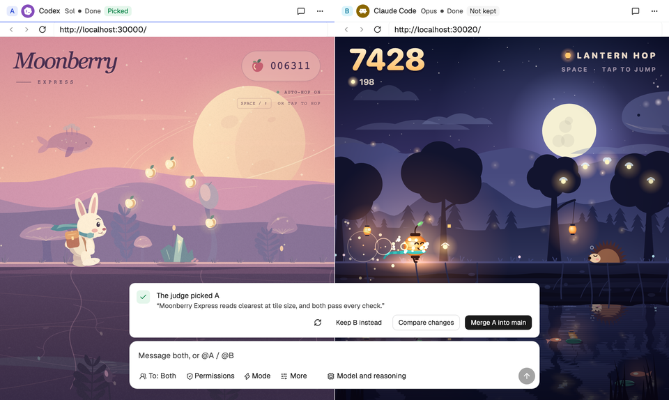
  </picture>
</p>

<p align="center"><sub>Two agents, one brief, a browser each. The judge picks; you merge.</sub></p>

<p align="center"><sub>Works with the agents you already run</sub></p>

<p align="center">
  <picture>
    <source media="(prefers-color-scheme: dark)" srcset="docs/images/agents-dark.svg" />
    
  </picture>
</p>

<p align="center">…or any agent that speaks ACP. <a href="docs/agent-capabilities.md">What each one can do →</a></p>

## See what each agent did, step by step

Write, check, review, fix, land: every Run follows the Flow you set. When a check fails or a reviewer asks for a change, you watch it loop back, and you see the one step waiting on you.

<p align="center">
  <picture>
    <source media="(prefers-color-scheme: dark) and (prefers-reduced-motion: no-preference)" srcset="docs/images/app/readme-run-dark.gif" />
    <source media="(prefers-color-scheme: dark)" srcset="docs/images/app/readme-run-dark-poster.png" />
    <source media="(prefers-reduced-motion: no-preference)" srcset="docs/images/app/readme-run-light.gif" />
    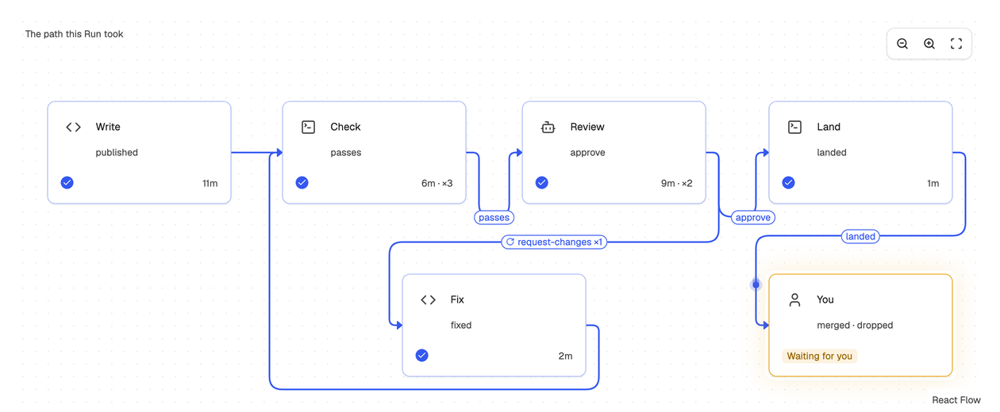
  </picture>
</p>

## Twelve jobs, one glance

Skip the tour of agent terminals. See what is working, what is in review and what is blocked on you, with the checks, the diff and the pull request on each card.

<p align="center">
  <picture>
    <source media="(prefers-color-scheme: dark) and (prefers-reduced-motion: no-preference)" srcset="docs/images/app/readme-board-dark.gif" />
    <source media="(prefers-color-scheme: dark)" srcset="docs/images/app/readme-board-dark-poster.png" />
    <source media="(prefers-reduced-motion: no-preference)" srcset="docs/images/app/readme-board-light.gif" />
    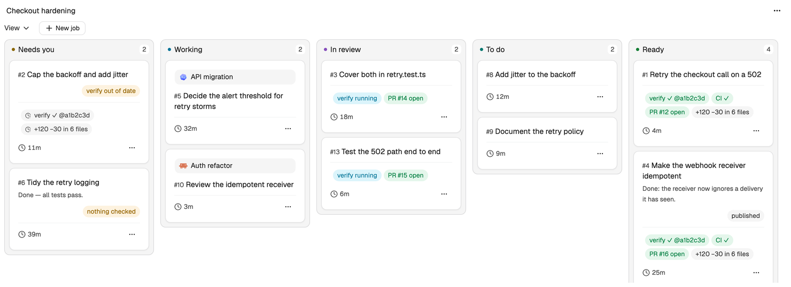
  </picture>
</p>

## Know what several agents cost you

<p align="center">
  <picture>
    <source media="(prefers-color-scheme: dark) and (prefers-reduced-motion: no-preference)" srcset="docs/images/app/readme-dashboard-dark.gif" />
    <source media="(prefers-color-scheme: dark)" srcset="docs/images/app/readme-dashboard-dark-poster.png" />
    <source media="(prefers-reduced-motion: no-preference)" srcset="docs/images/app/readme-dashboard-light.gif" />
    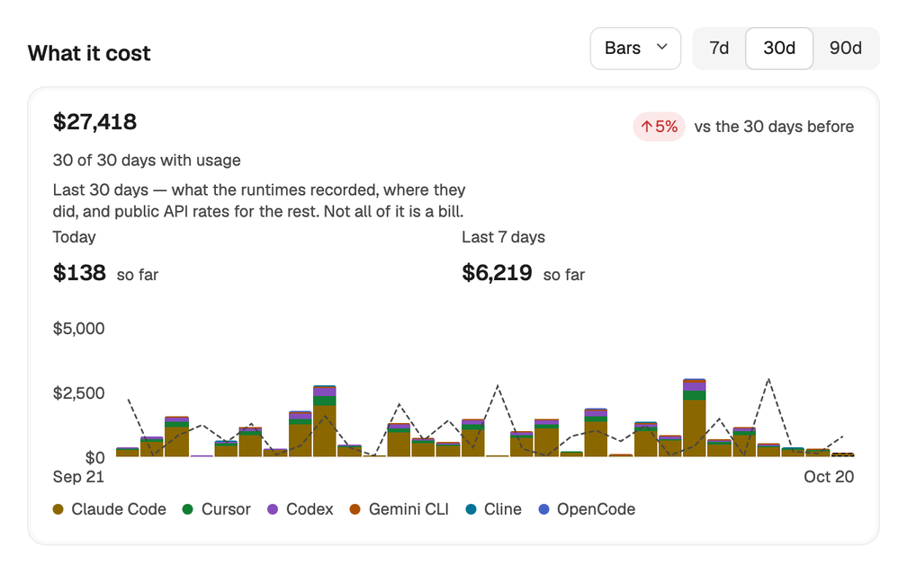
  </picture>
</p>

<p align="center"><sub>Which agent spent what · Before a limit stops you · Where the work went. <a href="docs/usage-dashboard.md">Docs →</a></sub></p>

## Run many agents without losing track

<table>
<tr>
<td width="50%" valign="top">
  <picture>
    <source media="(prefers-color-scheme: dark)" srcset="docs/images/app/readme-tour-teams-dark.png" />
    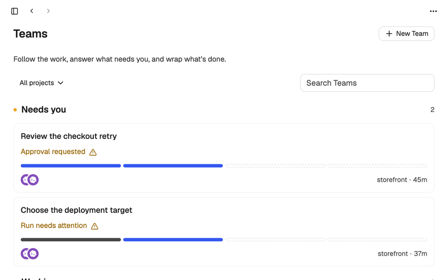
  </picture>

**Every Team, one board**<br/>
See what needs your answer, what is working and what is ready, across every agent in the Team. [Docs →](docs/interface.md#the-teams-page)

</td>
<td width="50%" valign="top">
  <picture>
    <source media="(prefers-color-scheme: dark)" srcset="docs/images/app/readme-tour-run-dark.png" />
    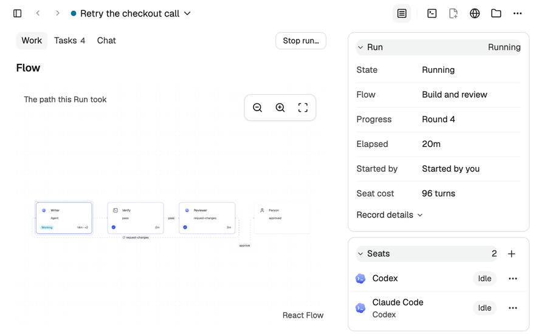
  </picture>

**Follow each step**<br/>
Watch write, check, review and fix as they happen, and see where a Run waits for you. [Docs →](docs/interface.md#a-teams-run)

</td>
</tr>
<tr>
<td width="50%" valign="top">
  <picture>
    <source media="(prefers-color-scheme: dark) and (prefers-reduced-motion: no-preference)" srcset="docs/images/app/readme-flows-dark.gif" />
    <source media="(prefers-color-scheme: dark)" srcset="docs/images/app/readme-flows-dark-poster.png" />
    <source media="(prefers-reduced-motion: no-preference)" srcset="docs/images/app/readme-flows-light.gif" />
    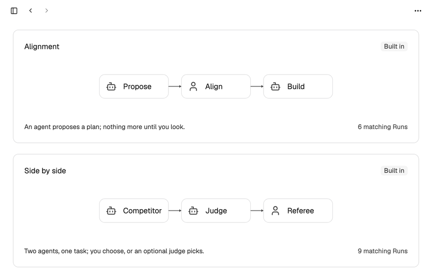
  </picture>

**Set the process once**<br/>
Set the steps, rules and triggers once, such as who checks, who reviews and what lands after both. [Docs →](docs/flows.md)

</td>
<td width="50%" valign="top">
  <picture>
    <source media="(prefers-color-scheme: dark)" srcset="docs/images/app/readme-tour-library-dark.png" />
    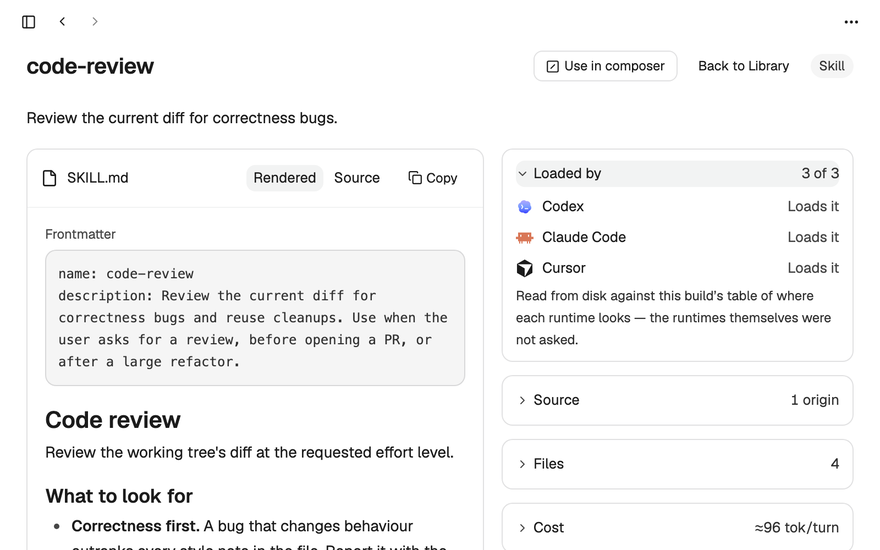
  </picture>

**See what each skill costs**<br/>
Open a skill from Customize in the sidebar to see who loads it, where it came from and what it costs, then trim the dead weight. [Docs →](docs/interface.md#settings)

</td>
</tr>
<tr>
<td width="50%" valign="top">
  <picture>
    <source media="(prefers-color-scheme: dark)" srcset="docs/images/app/readme-tour-runtimes-dark.png" />
    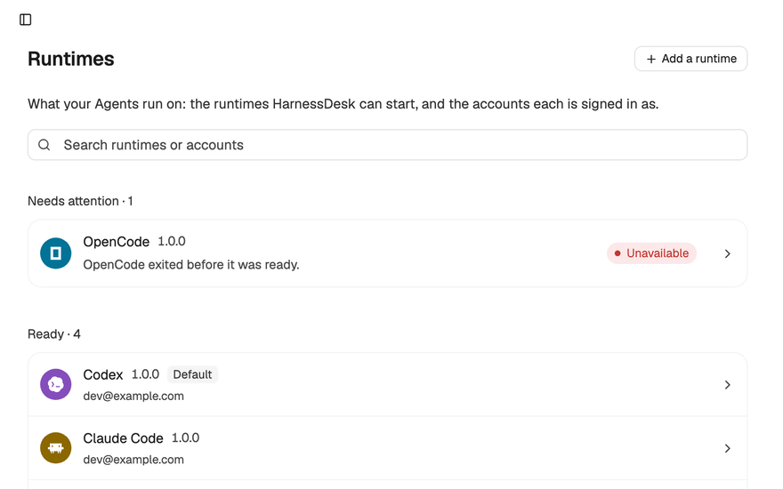
  </picture>

**Every runtime, ready or not**<br/>
See which agents are ready, which need attention and why, and which account each signs in with. [Docs →](docs/runtimes.md)

</td>
<td width="50%" valign="top">
  <picture>
    <source media="(prefers-color-scheme: dark)" srcset="docs/images/app/readme-tour-chats-dark.png" />
    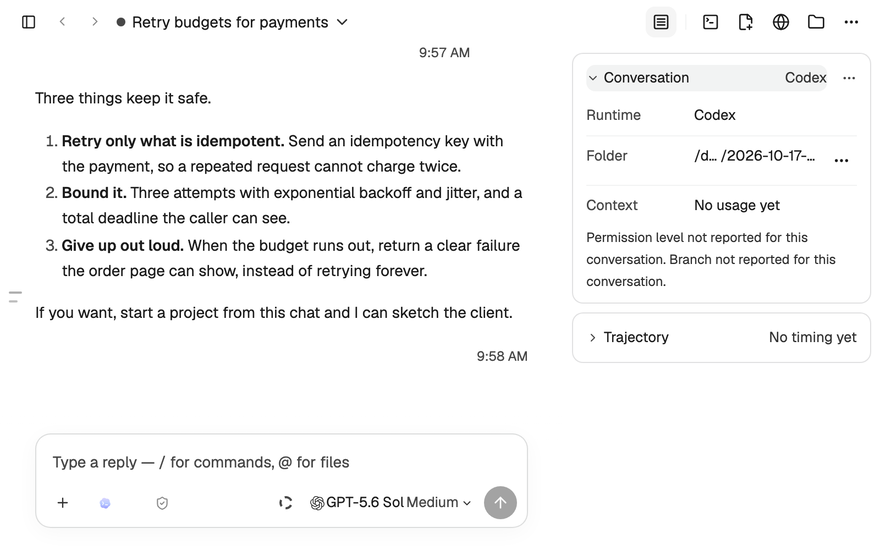
  </picture>

**Ask first, pick a folder later**<br/>
Start a chat before you choose a project: it gets a folder of its own and waits under Chats. [Docs →](docs/interface.md#the-sidebar)

</td>
</tr>
</table>

## The same Run, from your terminal

Script it, or let your agent run it. [Docs →](docs/cli.md)

<p align="center">
  <picture>
    <source media="(prefers-color-scheme: dark) and (prefers-reduced-motion: no-preference)" srcset="docs/images/app/anim-cli-dark.svg" />
    <source media="(prefers-color-scheme: dark)" srcset="docs/images/app/anim-cli-dark-poster.png" />
    <source media="(prefers-reduced-motion: no-preference)" srcset="docs/images/app/anim-cli-light.svg" />
    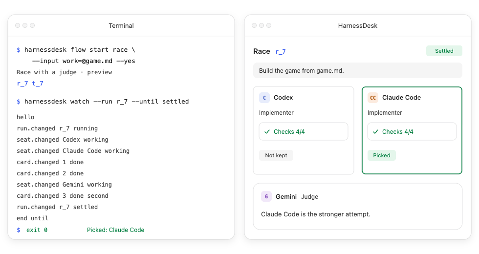
  </picture>
</p>

## Bring your agents. Keep your setup.

- **No new bill.** Each agent keeps its own sign-in, so the plans you already pay for keep working. HarnessDesk is free and adds nothing on top.
- **Your code stays with you.** Agents work in your own folders, and the desk keeps its records on your machine. [Data boundaries →](docs/data-boundaries.md)
- **Read it before you trust it.** Every line is open under the MIT license.

**Also in the box:**

- **[Hand-off](docs/multi-agent.md#2-hand-offs-passing-the-baton):** pass a conversation to another agent with a packet it can pick up.
- **[A browser per Seat](docs/browser-control.md):** each agent opens, clicks and reads its own pages.
- **[Agents](docs/agents.md):** reusable briefs and ceilings, with ten built-in roles to start from.
- **Plugins.** Twelve built in. HarnessDesk projects its 74 built-in plugin tools into each agent’s tool interface. [Docs →](docs/extending.md)
- **[One policy, one audit log](docs/architecture.md):** the same rules, whichever agent asked.

## Account, phone and Lead

Settings › Account opens sign-in in your system browser. Approve the named desk
and matching code there; return to manage its name, sign out, or delete the
account. Agent sign-ins and local work remain separate. The host's requests and
stored data are listed in [data boundaries](docs/data-boundaries.md#harnessdesk-account--only-after-you-choose-sign-in).

With local phone access enabled, Settings › Phone shows a code to scan on the
same network. Allow the phone on the desk; pairing needs no account link.
Settings › Permissions controls Git write steering and its project overrides;
the Git record shows gateway writes and observed outside heads.

Lead is an optional conversation for planning work, approving its allowances
and following workers, checks and reviews. It requires a host running Node 25+
and the startup opt-in `HARNESSDESK_LEAD=1`. The current desktop embeds an older
runtime and shows Lead as unavailable when enabled; ordinary sessions remain
usable. See [the interface](docs/interface.md#lead).

## Install

Download the signed, notarized app for macOS 13+, Apple silicon or Intel, from the [latest release](https://github.com/HarnessDesk/HarnessDesk/releases/latest). It updates itself. Then bring an agent you already use: [getting started](docs/getting-started.md) covers installing and signing in to the main ones, and how to add any other agent from the ACP registry or by its own command.

**Build from source** with Node 22.19+ and pnpm 10:

```bash
pnpm install
pnpm build
pnpm app
```

[CONTRIBUTING.md](CONTRIBUTING.md) is the way in; security reports go to [SECURITY.md](SECURITY.md).

## Licence

MIT. HarnessDesk is an independent project, not affiliated with, endorsed by, or sponsored by any of the vendors whose agents it drives; their names appear here only to identify their software. The extension kernel is DeepSeek's Cordis (MIT), and the Codex protocol types are generated from `openai/codex` (Apache-2.0). See [THIRD_PARTY_NOTICES.md](THIRD_PARTY_NOTICES.md) and [TRADEMARKS.md](TRADEMARKS.md).
