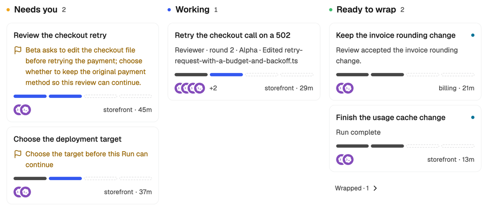
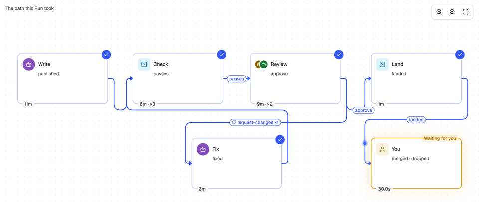
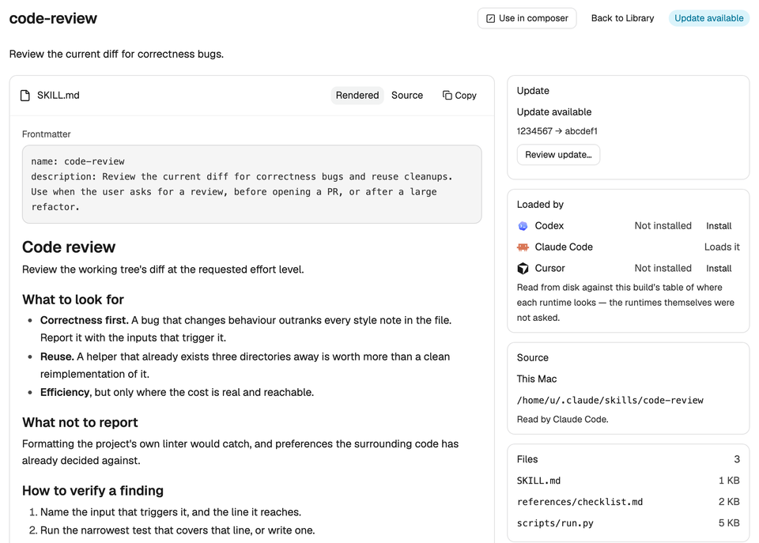
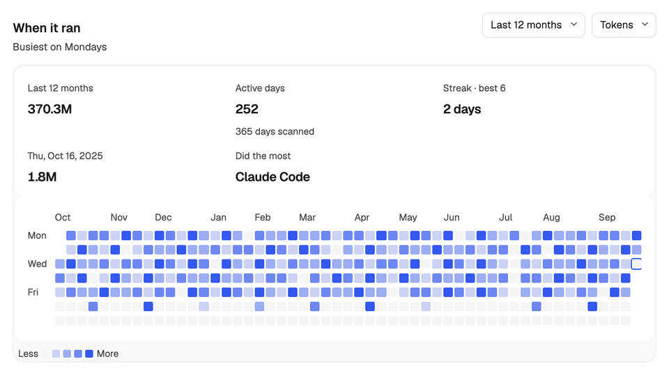

<h1 align="center">
  <picture>
    <source media="(prefers-color-scheme: dark)" srcset="assets/brand/svgs/harnessdesk-icon-white-transparent.svg" />
    
  </picture>
  HarnessDesk
</h1>

<p align="center">
  <a href="https://github.com/HarnessDesk/HarnessDesk/releases/latest"></a>
  
  <a href="LICENSE"></a>
</p>

<p align="center">
  <strong>Your coding agents, working as a team.</strong><br/>
  Race Codex, Claude Code, Cursor and a dozen more on one task, let them check each other’s work, and decide what lands.
</p>

<h3 align="center"><a href="https://github.com/HarnessDesk/HarnessDesk/releases/latest"><ins>Download for macOS</ins></a> · <a href="docs/README.md"><ins>Documentation</ins></a></h3>

<p align="center">
  <picture>
    <source media="(prefers-color-scheme: dark) and (prefers-reduced-motion: no-preference)" srcset="docs/images/app/readme-race-dark.gif" />
    <source media="(prefers-color-scheme: dark)" srcset="docs/images/app/readme-race-dark-poster.png" />
    <source media="(prefers-reduced-motion: no-preference)" srcset="docs/images/app/readme-race-light.gif" />
    
  </picture>
</p>

<p align="center"><sub>Two agents, one brief, a browser each. The judge picks; you merge.</sub></p>

## Features

<table>
<tr>
<td width="42%" valign="middle">

### Teams

Every Team on one board, with the work that needs you first.

[Docs →](docs/interface.md#the-teams-page)

</td>
<td width="58%">
  <picture>
    <source media="(prefers-color-scheme: dark)" srcset="docs/images/app/readme-teams-dark.png" />
    
  </picture>
</td>
</tr>
<tr>
<td width="42%" valign="middle">

### Flows

Set who writes, who reviews, which checks run and where you step in. Every Run keeps the route it took.

[Docs →](docs/flows.md)

</td>
<td width="58%">
  <picture>
    <source media="(prefers-color-scheme: dark)" srcset="docs/images/app/readme-flow-dark.png" />
    
  </picture>
</td>
</tr>
<tr>
<td width="42%" valign="middle">

### Library

Skills and MCP servers across every agent you use, and which agents actually load each one.

[Docs →](docs/interface.md#settings)

</td>
<td width="58%">
  <picture>
    <source media="(prefers-color-scheme: dark)" srcset="docs/images/app/readme-skill-dark.png" />
    
  </picture>
</td>
</tr>
<tr>
<td width="42%" valign="middle">

### Dashboard

A year of work across every agent and account: what it cost, what is left, and when you work.

[Docs →](docs/usage-dashboard.md)

</td>
<td width="58%">
  <picture>
    <source media="(prefers-color-scheme: dark)" srcset="docs/images/app/readme-dashboard-dark.png" />
    
  </picture>
</td>
</tr>
<tr>
<td width="42%" valign="middle">

### Command line

Script it, or let your agent run it: the same Runs from a terminal.

[Docs →](docs/cli.md)

</td>
<td width="58%">
  <picture>
    <source media="(prefers-color-scheme: dark) and (prefers-reduced-motion: no-preference)" srcset="docs/images/app/anim-cli-dark.svg" />
    <source media="(prefers-color-scheme: dark)" srcset="docs/images/app/anim-cli-dark-poster.png" />
    <source media="(prefers-reduced-motion: no-preference)" srcset="docs/images/app/anim-cli-light.svg" />
    
  </picture>
</td>
</tr>
</table>

**Also in the box:**

- **[Hand-off](docs/multi-agent.md#2-hand-offs-passing-the-baton)** — pass a conversation to another agent with a packet it can pick up.
- **[A browser per Seat](docs/browser-control.md)** — each agent opens, clicks and reads its own pages.
- **[Agents](docs/agents.md)** — reusable briefs and ceilings, with ten built-in roles to start from.
- **[Every account](docs/runtimes.md)** — several sign-ins per agent, and how much each one has left.
- **Plugins.** Twelve built in. HarnessDesk projects its 73 built-in plugin tools into each agent’s tool interface. [Docs →](docs/extending.md)
- **[One policy, one audit log](docs/architecture.md)** — the same rules, whichever agent asked.

## Supported agents

<p align="center">
  <picture>
    <source media="(prefers-color-scheme: dark)" srcset="docs/images/agents-dark.svg" />
    
  </picture>
</p>

<p align="center">…and Hermes Agent, pi, OpenClaw, or any agent that speaks ACP.</p>

Each agent keeps its own sign-in, skills and history; HarnessDesk reads them where they live. A control for something an agent cannot do is simply not drawn — [what each one can do →](docs/agent-capabilities.md)

## Install

Download the signed, notarized app for macOS 13+, Apple silicon or Intel, from the [latest release](https://github.com/HarnessDesk/HarnessDesk/releases/latest). It updates itself. Then bring an agent you already use — [getting started](docs/getting-started.md) covers each one.

**Build from source** — Node 22.19+ and pnpm 10:

```bash
pnpm install
pnpm build
pnpm app
```

[CONTRIBUTING.md](CONTRIBUTING.md) is the way in; security reports go to [SECURITY.md](SECURITY.md).

## Licence

MIT. HarnessDesk is an independent project, not affiliated with, endorsed by, or sponsored by any of the vendors whose agents it drives; their names appear here only to identify their software. The extension kernel is DeepSeek's Cordis (MIT), and the Codex protocol types are generated from `openai/codex` (Apache-2.0). See [THIRD_PARTY_NOTICES.md](THIRD_PARTY_NOTICES.md) and [TRADEMARKS.md](TRADEMARKS.md).
