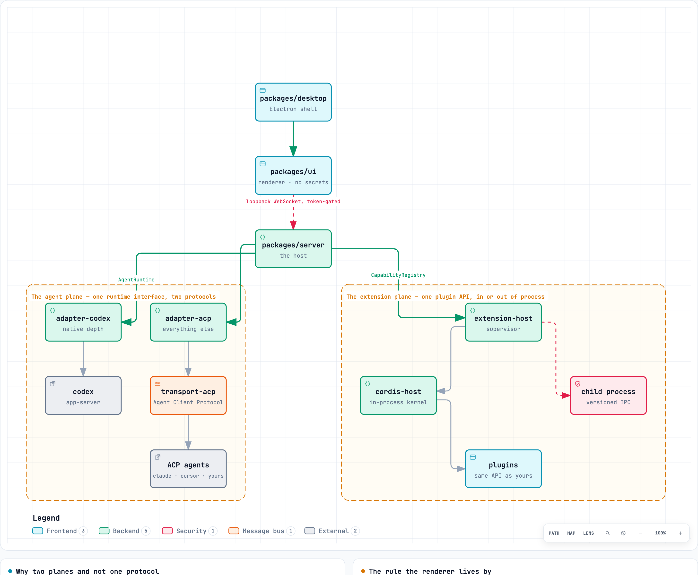
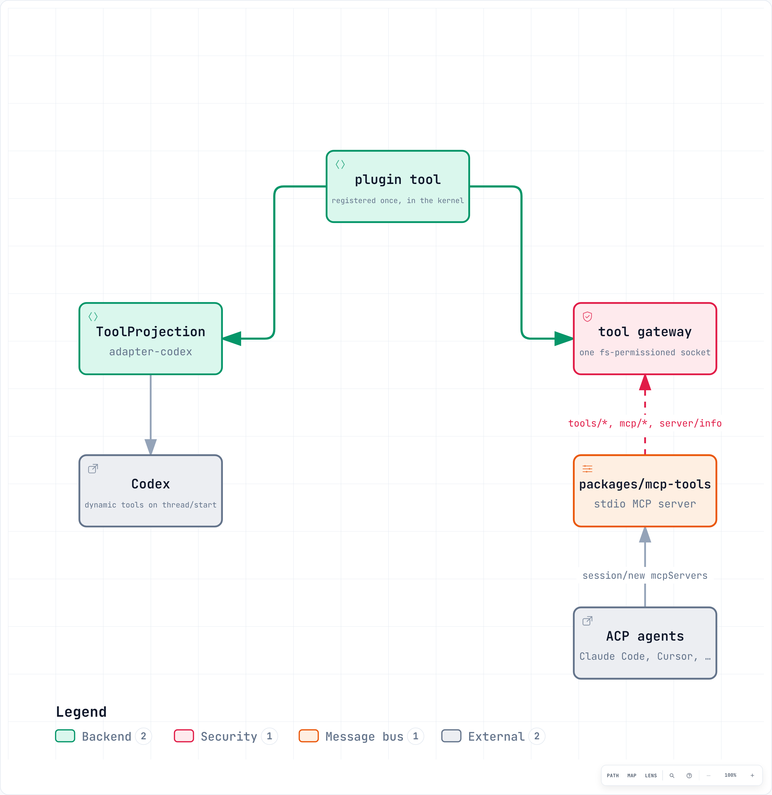

# HarnessDesk architecture

*The system as built, read off the code on 2026-09-12. When this and the code
disagree, the code is right and this is a bug.*

HarnessDesk is a macOS desktop app that drives coding agents it does not own.
It has three primitives — **agents**, **extensions**, and **workspaces** — and
two extension axes that are kept apart on purpose.

The window and every client read a Team through the same selectors in `@harnessdesk/client/views`.

## The two planes

|  | Question | Answer | Boundary enforced by |
| --- | --- | --- | --- |
| **Agent plane** | Who does the work? | An `AgentRuntime` per agent: Codex natively, everything else over ACP | `pnpm layering` — Codex types never leave `packages/adapter-codex` |
| **Extension plane** | What can they do? | Plugins on a Cordis kernel, projected into each agent's own tool dialect | `pnpm layering` — Cordis never leaves `packages/cordis-host` |

They are orthogonal, and that is the whole point: a plugin registered once is
usable by every agent, and an agent added once can use every plugin. Collapsing
them into one protocol would give up both properties.

  <picture>
    <source media="(prefers-color-scheme: dark)" srcset="diagrams/architecture-dark.png" />
    
  </picture>

> Generated from [`diagrams/architecture.architecture.json`](diagrams/architecture.architecture.json),
> which is the thing to edit and the thing a reviewer reads — a diagram that
> only exists as a picture cannot be reviewed. The same source renders an
> interactive version, [`diagrams/architecture.html`](diagrams/architecture.html):
> searchable, traceable, with light and dark and export built in. **GitHub
> shows a committed `.html` as source rather than rendering it**, so that one
> is worth opening locally rather than clicking here.
>
> Both come from `node script/diagram-export.mjs` and
> `docs/diagrams/README.md`.

## The packages

Twenty-four packages make up the repository:

| Package | Role | Allowed imports |
| --- | --- | --- |
| `packages/protocol` | Domain vocabulary, wire methods, validators | Zero dependencies |
| `packages/contract` | Schemas for the cloud wire: ids, tokens, pairing offers, relay frames, the account API. See [open-and-hosted.md](open-and-hosted.md) | `zod` |
| `packages/crypto` | The cloud wire's cryptography: keys, handshake and framing, signed tokens, push sealing, test vectors | Zero dependencies (WebCrypto) |
| `packages/phone-link` | Desk identity, phone enrollment and encrypted LAN sessions | `contract`, `crypto`, `ws`, Node built-ins |
| `packages/desktop` | Electron shell, Keychain broker, packaging, the command-line launcher | `server`, `claude-acp`, `cursor-acp`, `cli`, `mcp-tools` |
| `packages/client` | Transport-independent client calls and events; local I/O in its `node` entry | `protocol`, and `ws`/Node in the Node entry |
| `packages/lead` | Portable Lead contracts and injected management ports | `protocol`, `client`; only the exact child.ts and supervisor.ts entries under its src directory may import their allowlisted Node modules and the client's Node entry; the core has no ambient machine or network authority |
| `packages/cli` | The `harnessdesk` command line over the client library; the app bundles it and installs a launcher for it, and `docs/cli.md` is its reference, generated from its command table | `client`, `protocol` |
| `packages/ui` | Renderer: AppStore snapshots, slot layout, panels | `protocol`, `client/views` (browser context only, no `node:*`) |
| `packages/server` | Host process: sessions, git, approvals, wire | `protocol`, `client/node`, adapters, `codex` (wiring in `bootstrap.ts` only), `cordis-host`, `plugins`, `extension-host`, `agent-inventory`, `responses-gateway`, `mcp-tools`, `ws` |
| `packages/adapter-codex` | Native Codex adapter for `codex app-server` | `protocol`, `codex` |
| `packages/codex` | Generated Codex JSON-RPC protocol client | Zero dependencies |
| `packages/adapter-acp` | ACP adapter driving stdio peers | `protocol`, `transport-acp` |
| `packages/transport-acp` | ACP line framing and transport | Zero dependencies |
| `packages/claude-acp` | Bundled Claude Code ACP bridge | `protocol`, `@agentclientprotocol/claude-agent-acp`, `@anthropic-ai/claude-agent-sdk`, `@agentclientprotocol/sdk`, `@modelcontextprotocol/sdk`, `zod` |
| `packages/cursor-acp` | Bundled Cursor ACP bridge for `cursor-agent` | `protocol` |
| `packages/adapter-testkit` | Conformance suite for any `AgentRuntime` | `protocol` |
| `packages/cordis-host` | In-process extension kernel, capability gates | `protocol`, `@deepseek-ai/cordis` |
| `packages/extension-protocol`| Versioned IPC contract for child plugin host | `protocol` |
| `packages/extension-host` | Supervisor for untrusted plugin child process | `protocol`, `cordis-host`, `extension-protocol` |
| `packages/plugins` | Twelve built-in plugins | `protocol`, `cordis-host` |
| `packages/mcp-tools` | Stdio MCP bridge for plugin tools to ACP | Zero dependencies (connects to unix socket) |
| `packages/responses-gateway` | Per-route loopback proxy for model routing | Zero dependencies |
| `packages/agent-inventory` | Standalone cross-agent skill and MCP scanner | `protocol`, Node built-ins |

The shell defaults to a macOS menu bar item only for the default `~/.harnessdesk` home. `HARNESSDESK_MENU_BAR=on` or `1` changes that launch default to on, and `off` or `0` to off. A person's explicit **View › Show Menu Bar Icon** choice is saved in that home's `menu-bar.json` and takes precedence over launch defaults, so an isolated desk can restore its own icon without adding icons to other worker desks.

## The agent plane

`packages/protocol` is the vocabulary every other package speaks: sessions,
turns, items, approvals, options, capabilities. It depends on nothing.

An adapter turns one agent into an `AgentRuntime`. Three ship:

| Adapter | Drives | Notes |
| --- | --- | --- |
| `adapter-codex` | `codex app-server` over stdio JSON-RPC | The deep one. `packages/codex` is the generated protocol client; `pnpm codex:protocol` regenerates it and `pnpm codex:drift` checks it. Dynamic tools, review, compaction, memory, undo, MCP, skills, plugins, rate limits. |
| `adapter-acp` | Any Agent Client Protocol peer, over `transport-acp` | Claude Code, Cursor, Gemini CLI, DeepSeek Harness and ~40 others. Configured in `~/.harnessdesk/agents.json`. |
| `adapter-testkit` | Nothing — it is the conformance suite | Every adapter passes it. Depends on the protocol and nothing else. |

Two ACP bridges ship in this repository because the published ones were not
enough:

- **`claude-acp`** — a thin compatibility layer over `@agentclientprotocol/claude-agent-acp` that
  forwards reasoning effort and remembers it per session. When a conversation is reopened the upstream
  loader's replay is the history (thoughts, tool kinds, diffs and locations are its own); the
  bridge re-reads only its user messages, so a stop marker is an Interrupted notice and what the
  person never typed is dropped or named, and replays the stored `.jsonl` itself only when the
  loader sent no part of the history (no message, thought or tool call). Every other update during a load passes as it came.
- **`cursor-acp`** — a real bridge onto `cursor-agent --print
  --output-format stream-json` (the npm `cursor-agent-acp` is a stub that
  ends every turn immediately). It decomposes Cursor's model catalogue into
  families × dimensions, exposes Max mode as a toggle, and keeps a session
  index so conversations survive the process.

**DeepSeek Harness joins here too, not deeper.** Its SDK protocol streams
richer events than ACP but has no cancel and no approvals, so a native adapter
would buy depth by losing the stop button and the one approval surface —
[the DSH decision](decisions.md#deepseek-harness-joins-over-acp-and-its-plugins-stay-in-its-own-profile) records the
measurement and names the upgrade path. (It runs on DSH's own ACP server,
`dsh --profile acp`, which takes HarnessDesk's tools per session and resumes a
conversation without replaying it; the desk keeps the transcript. See
[the DeepSeek decision](decisions.md#deepseek-runs-on-dshs-own-acp-server-and-its-tools-arrive-with-the-session).)

**The machine decides which copy runs.** The row in `agents.json` is the
fallback; before every start the host finds every copy of the agent on the
machine (PATH as the login shell sees it, vendor install directories, and the
desk's own staged downloads), asks each for its version, and runs the newest
that meets the agent's floor, or the one the person pinned
([the install decision](decisions.md#the-row-is-the-fallback-the-machine-decides-which-copy-runs)). Binary distributions
from the public ACP registry are verified against registry digests, staged
atomically, and deleted when removed (`packages/server/src/acp-registry.ts`).

**Capabilities are negotiated, not hard-coded.** Each adapter fills in a
`RuntimeInfo` — what it can do, what it is called, how it signs in — and the
interface renders that ([the capability decision](decisions.md#capabilities-are-negotiated-not-normalised)).
Full depth on Codex's app-server when Codex is selected, full ACP everywhere
else, one code path. The UI never names a runtime: every user-visible string
about an agent comes from `RuntimeInfo.presentation`, and a brand name in a
component fails `pnpm layering`.

**HarnessDesk never runs the agent's commands.** Codex and every ACP agent
already ship a sandbox — Seatbelt, Landlock, an ACL. Duplicating it would mean
two policies, one of them weaker. HarnessDesk permanently declines ACP's `fs`
and `terminal` client capabilities: execution belongs to the agent. Because
ACP agents expose no command execution for the interface, terminals beside a
conversation prefer a ready runtime with sandboxed process support
(`runtime.processes` in `adapter-codex`), then one whose start is already in
progress, then an idle one whose managed spawn starts it through the host's
stop/start barrier. Among multiple ready providers, account reads run in order
and each is bounded to two seconds; a late or failed read counts as signed
out. The first provider with a signed-in account or no sign-in method hosts.
If all are signed out, the first ready provider whose account read answered
still hosts; only when every read failed or was late does the first ready
provider stand in. The two-second deadline is per provider, and a failed or
late read leaves a warning in the host log. Sign-in never prevents a terminal.
Unavailable providers are skipped; when none is available, the terminal is
refused in the requested agent's name.

Sandboxed process startup waits for an acknowledgement, rather than a grace
timer. The adapter follows `command/exec` with one `command/exec/write` carrying
an empty `deltaBase64`; the server serializes these requests by process id and
acknowledges the write only when the child handles controls. It sends no stdin
bytes and leaves stdin open. The deferred exec response still owns exit: if
the child finishes before the write can be acknowledged, that response decides
between a normal exit and a rejected spawn, preserving a delayed refusal's
original error. This uses the control behavior present in the supported
[0.145.0 server](https://github.com/openai/codex/blob/rust-v0.145.0/codex-rs/app-server/src/command_exec.rs).

## The host

### The git gateway

`packages/server/src/git-gateway/` is the shared publication engine for the
Lead and the Git plugin's `ctx.forge` writes. `HostContext.gitGateway` exposes
it to wire handlers; plugins receive the forge capability, never the engine,
its executor or a credential. The host derives the requester from the live
invocation. A tool cannot choose another conversation or repository.

**Executors.** Pushes copy an exact reviewed commit and tree from the worker's
object store into a private, host-owned bare mirror under `git-gateway/` in
host state. The mirror's configuration disables hooks, checks transferred
objects and permits HTTPS; pushes carry explicit refspecs and leases. Worker
remotes, URL rewrites, credential helpers, askpass programs and hooks do not
choose the destination or run with the host's credential. A one-shot helper
consults the person's Git credential configuration outside every checkout,
then falls back to `gh auth git-credential`. Forge mutations run `gh` from the
host state directory with the pinned repository, explicit `--repo` or API
paths and prompting disabled. PR creation, update, merge, review and comments
use this executor. A recorded gateway continuation can satisfy the plugin’s
preliminary publication check even when the checkout’s upstream ref is stale;
the host still verifies the actual remote head before opening the PR. Merge is bound to the reviewed head and the existing
required-check gate. A Flow's automatic PR merge also requires the host's
recorded review of the pinned repository, PR number, head, destination ref and
destination tip. The gateway rechecks that tuple and the live authority before
launch; this is a preflight, not an atomic lease on GitHub's base branch.
Unbound older reviews remain readable but need a fresh PR review to authorize
that merge. An interrupted or queued merge remains unresolved until the PR is
observed merged, and cannot be silently resubmitted. An open, unqueued snapshot
cannot prove that an earlier request has stopped; a person may need to inspect
or complete it externally.
An unpinned project's explicit GitHub origin can still supply an informational
PR review; adding a pin later does not promote that earlier review.
The mutation queue is per host gateway. Another host or an external client
does not share that queue, so this is not cross-process exactly-once merging.

The gateway clears proxy environment variables and uses its own Git
configuration. It does not fall back to global/system Git proxy configuration
or desktop proxy settings. A network requiring one can refuse publication.
Forge reads still run through the Git plugin's shell grant and can reach the
person's write-capable `gh` login; this implementation isolates the gateway's
credential path, not all ambient credentials available to an agent.

**Pins.** An origin URL is a proposal until the person approves the first push
for a project. `git-pins.json` in host state stores the canonical project root,
repository, approving requester and time. Later writes use that pin; changing
a checkout's origin cannot change it. A mismatching origin refuses a write.
First branch pushes and rewrites ask; continuations on a branch the same
conversation created and still owns can proceed without another push card.
A steering approval substitutes for the first-push question only when its
repository, branch and SHA match. A rewrite still asks. Agents cannot push a
default or protected base branch.

**The git record.** `git-record/<owner>__<name>.ndjson` in host state holds
append-only entries: `id`, `prev`, operation, repository, optional branch/PR
number/head/previous head/lease, requester, approval, optional redacted
`steeredFrom`, timestamp and outcome/reason. Requesters are sessions, Lead
goals, the person or `outside`. Operations are `push`, `pr.create`,
`pr.update`, `pr.merge`, `pr.comment`, `pr.review`, `issue.comment`,
`observed`, `pr.thread.resolve` and `pr.thread.answer`. An intent is flushed before the effect; its outcome is appended
with the same id before returning. Writes are serialized per repository.
Each physical line's `prev` hashes the preceding line, including its newline;
rotated segments retain the chain and a separately flushed anchor remembers
the tail and line count. Damage is inspectable but cannot authorize a write
or attribution. This detects damaged history, not a malicious same-user
rewrite of every state file.

Recovery reads unfinished intents. It compares a pending push with the remote
head, records a matching result as reconciled, and leaves an unavailable
remote pending for a later attempt. Forge mutations are never replayed after
an uncertain crash: they become interrupted failures because the host cannot
prove that the forge did not already accept them. Lead adoption still needs
a successful push for the exact repository, branch, SHA and requester through
`hasSucceededPush`; an intent or a caller's incomplete journal is insufficient.

**Review threads.** After a repair round a seat settles each review thread by its outcome, through `ctx.forge.settleThread`: a thread the fix addressed is resolved with GraphQL `resolveReviewThread` and nothing is posted; a suggestion the seat declined is answered with exactly one plain sentence (at most 280 characters, one line, with no link, markup, `@`, or reference to another issue or pull request) and left open for the reviewer. Before either write the gateway reads the pull request's threads itself, so the thread's membership in that pull request, its author and whether that author is a bot come from the forge, never from the plugin. The host prefixes the desk marker line to an answer, so intake and `deskPosted` know it as the desk's own. A thread is answered at most once, and one bot reviewer's threads on one pull request are settled in at most three distinct repair rounds; a person reviewer is not capped, and an author the forge no longer names is counted as a bot. Inside a Team the round is the seat's review round. Outside one it is the turn the host has running for that conversation, which the tool bridge passes with every call, so one turn settling many threads is one round; a call with no turn the host can name settles no bot thread and leaves it to the person. A reply counts as the desk's answer only when it carries the desk marker and was written by the account the desk is signed in as. Both facts live in `review-threads.json` in host state, replaced atomically and noted before the write; the note is taken back when the write never reached `gh` or the forge refused it outright. A record that cannot be read, or is not the expected shape, is moved aside as `review-threads.json.corrupt-<time>` and never read as empty: agents then settle nothing on the pull requests it still names (on any, when it names none) until the person settles a thread there or removes the moved-aside file, and for a day at most. `ctx.forge.reviewThreads` is the matching read: one fixed GraphQL query with the repository and number passed as variables, returning each thread's id, path, line, author, bot flag, resolved and answered state and its first comment, bounded; the pull request title, each path and each comment reach the agent inside a block marked untrusted, the title and path on one line, and a read with more than one page says the list is cut off ([why](decisions.md#review-threads-are-settled-by-outcome--2026-11-10)).

**Attribution and observation.** `attribute(repository, branch, sha)` credits
only a successful gateway push in intact history. A fetched head without
that proof gets an `observed` entry with `requester.kind = outside`; commit
authors are not evidence of who pushed. A receipt from an own-git command
only triggers a remote read: its exit code never proves a head was written.
Both these observations and person-allowed own-git observations honor
`recordOutside`; gateway writes are always recorded. PR lifecycle keeps
following checks and reviews after an outside change releases branch
authority. Only the existing head-bound reclaim decision restores it.

**Steering.** The three layers share the protocol parser: per-conversation
PATH stand-ins, native approvals or the bridge's pre-tool callback, and
completed command observation. Login-shell scripts are unwrapped without
execution. The zsh installer sources the user's normal profile files and
restores PATH after login profiles. Profile files run with the user’s original
`ZDOTDIR`, and `HISTFILE` defaults there. The shim remains the shell’s
`ZDOTDIR` between profiles so steering survives login PATH resets; system
startup code that uses it for completion caches can place those caches in
the stand-in directory. Known reads take a shell fast path;
non-write verbs pass through, and aliases are read from real git configuration.
Aliases expanding to writes use the same parser; opaque shell aliases and
unsupported mutations refuse in Ask and Always modes.
An unreachable steering socket refuses a write. Shells carry a separate
steering-only caller token, rejected by the general tool and MCP maps; real
binary children do not inherit the desk tool tokens. A disconnected caller
cancels its held card before invocation. Forge body files are read only after
admission, as bounded regular files confined to the checkout, with nonblocking
opens and a 64 KiB cap. Recorded command text omits bodies and URL userinfo.

`gitWrites.steer` defaults to `ask`; `redirect` and `off` correspond to Always
and Never. `gitWrites.projects[root]` overrides the global choice, with
`inherit` as the default. An installed stand-in and Claude callback consult
the host's current mode, so switching to Never releases an open conversation.
Successful native pushes still observe the pinned remote when outside recording
is enabled, without a steering question or outside-write banner.
A conversation opened with Never has no installation; enabling steering needs
a new conversation. Generic ACP has no negotiated per-session process-
environment channel, so steering currently requires an isolated worker
process per conversation even for normally shared peers. That lifecycle cost
remains explicit until such a channel is measured and supported.

The renderer reads `git/record/list` and `git/record/attribute`; roots are
confined to admitted workspaces. List pages collapse intent/outcome pairs to
the latest state, include All/Outside/Refused counts and use an id cursor.
A PR's page includes its branch pushes and outside observations. There is no
record notification: branch/PR publications and window focus refetch it.

### Insight reads

Insight is a host-owned, pull-only plane over the ledger's agent-owned source
files, durable transcript metadata, Seats and immutable Goal documents. It has
no evidence or receipt writer port. Its wire methods return source and
coverage-qualified observations; a local seating apply accepts only a
host-minted reviewed stamp and checks the seating file in its write queue.
A read for many Teams (`insight/goals`) makes one pass over the usage sources
for all of their projects (`Ledger.readInsights`: roots over the same range
share a pass, which carries each read's byte budget and files its samples by
folder once), attributes each
sample to its Seat once per project, then draws every Team's report from
that; one read shares its folder identities rather than resolving a path per
sample.

`packages/server` owns everything that must not live in a browser:

- **HarnessDesk account** (`harnessdesk-account.ts`) — a separate host service
  owns the desk's Ed25519 identity, browser approval polling, renewable desk
  session and account metadata. The renderer uses `account/*` and
  `account/changed`, never the cloud contract or a credential. The desktop
  supplies its existing keystore cipher and `shell.openExternal`; this account
  refuses the standalone host's plaintext fallback. Each cloud origin has its
  own `account-<origin hash>.sealed` file containing only encrypted key,
  pending approval, session and cached account data, excluded from backups.
  A readable legacy `account.sealed` migrates to its recorded origin. Opaque
  or unreadable storage is preserved and blocks replacement sign-in.
  Cancellation and startup use the saved key to revoke approved but
  unfinished sign-ins, best effort; neither cleanup signs the renderer in.
  `account/delete` deletes the cloud account with the desk session, then clears
  this origin's sealed identity through the same path as sign-out and emits
  `account/changed`. A 401 on deletion or session renewal clears the identity
  too, allowing a retry after a lost success response. Other failures keep the
  local identity; there is no local-only account deletion.
  Account pictures are bounded host-fetched raster data from public HTTPS
  addresses; the renderer retains its self/data/blob image policy. Desk name
  and the phone-access preference live in ordinary preferences.
  `HARNESSDESK_CLOUD_URL` selects an HTTPS origin (default
  `https://app.harnessdesk.app`; HTTP loopback is allowed for local rigs).
  Polling and metadata refresh stop with the host. Cancel fences queued and
  in-flight approval work. The `harnessdesk://` protocol only focuses the app;
  it never authenticates a desk. The account also hands the phone link what
  the relay needs — a desk session that names the relay and carries its own
  token, a signature of the relay's challenge, and one-time invites — without
  the desk key leaving it.
- **Account reads** — host calls through a registered runtime share one
  in-flight read per account generation, including its lifecycle waits. Callers
  receive an error after ten seconds. A deadline cannot cancel the adapter, so retries
  receive that same error until the underlying read settles, rather than
  starting more work. Settlement releases the hold without caching the answer;
  another account or a replacement registration has its own hold. An
  account-change event hands the callers of an older shared read to a fresh
  read that begins after it, and releases the older hold: nobody waits for the
  old adapter, is answered by it, or is failed by a change that was not theirs
  to retry ([why](decisions.md#an-account-change-hands-the-reads-in-flight-to-a-fresh-read)).
  An event with no read in flight starts none. A deadline logs
  one warning with the runtime named. Removing or replacing the registration and
  closing the host clear its deadline and reject callers still waiting.
- **Sessions and events.** One registry, fanned out to every connected client;
  the sidebar reads `session/index` from `sessions.sqlite`, a host-owned
  metadata index. Lifecycle writes and settled transcript observations update
  its rows, while `session/indexChanged` carries incremental changes. Its
  first page consults neither an agent nor Git. Repository cache misses run
  in the background, four at a time; the upgrade seed reads the old stores
  once without changing them. Native archive rows start unresolved, and background
  listings confirm only indexed ids. Cached folder identities and Git configuration
  fingerprints are revalidated without holding up a listing. Reconnects reconcile
  the window's loaded index pages; agent filters page their accounts. Team members are excluded from loose rows.
  `session/list` retains the runtime history contract through
  `historyClient.nativeList`; Archive pages the local index instead.
  Managed checkout inventory lives separately from session rows and survives
  body or row removal. Archive, delayed Remove sweeps and deletion share the
  checkout cleanup path; returning restores the retained branch before resume.
  After full native archive listings, unresolved indexed ids are read individually,
  three at a time, without delaying an index page.
  The host keeps its own copy of each session so a reload rebuilds without
  asking the backend to replay. An agent restarting under an open conversation
  — a catalogue refresh when the window regains focus, a stored key changing —
  drops the live handle but not the transcript, and the next thing said in that
  conversation reopens it (`resumeSession`, free of tokens). Only an agent that
  is *down*, one that keeps nothing to resume from, or one that cannot say
  which folder the conversation worked in refuses — and then it says which,
  rather than asking for a resume the interface does not offer. The folder is
  the agent's word or nothing: an ACP conversation reopens in the folder its
  agent's `session/list` records — or, for an agent that keeps no listing, the
  one it accepted when this run of the app opened the conversation — never in
  the host's own working directory.
- **History imports** (`history-import.ts`) — on-request, cancellable metadata
  scans in the existing `sessions.sqlite`. The `history/*` methods expose import,
  status, cancellation, title-filtered pages, removal and cached-body clearing.
  `historyClient` in `@harnessdesk/client` takes the authenticated host transport's
  request function; these storage operations are outside the tiered external
  `Client`. Settings and the palette reach a separately paged, windowed History view.
  Import progress lives in the renderer snapshot; host events invalidate its
  pages, and opening a preview does not seed the sidebar.
- **Transcripts** (`transcripts.ts`) — the host records what the backend does
  not keep. Codex's own protocol says it "explicitly do[es] not persist all
  agent interactions, such as command executions"; Cursor keeps nothing
  readable; ACP replay is lossy. The host's copy is what a reopened
  conversation shows, enriched with tokens remembered across restarts.
  Closed, quiet conversations can retain only metadata and reopen state in the
  registry. Releasing a body requires an exact SQLite write, independent
  readback and unchanged record authority; a successful write alone is not
  permission to discard it. Failed, partial or conflicting writes keep their
  observed material protected. New generations cannot replace an older
  generation's unacknowledged body. Host recovery descriptors have a separate
  8 MiB logical serialized budget; a failed reservation keeps the body loaded.
  Reading a closed conversation returns its full durable transcript without
  retaining the body in the next sync. Working conversations keep their live
  bodies, approvals and queued input. Removed workspace folders are excluded
  from capture and roster watches when the project set next reconciles.
  The renderer targets at most 128 eligible bodies or 8 MiB of their canonical
  UTF-8 turns. Only hidden, closed, quiet, unowned bodies with matching Host
  snapshot and durability receipts are eligible. Mounted views, drafts,
  requests, approvals, queues and uncertain material stay protected and may
  exceed these soft targets. Receipts bind Host epoch, record generation,
  revision, notification sequence and body identity. Gaps and stale replies
  cannot authorize unloading. Restoration uses an authoritative Host snapshot
  without starting an agent. These budgets do not cap process RSS, all
  metadata or protected pending activity, and a receipt cannot guarantee
  storage remains available after it was issued.
- **Approvals and the permission engine** — one policy, applied before any
  backend's own question reaches the user, and one append-only audit log
  (`audit.ndjson`).
- **The message queue** ([message-queue.md](message-queue.md)) — what the user
  typed while a turn was running, sent one message per turn when it ends. It
  belongs here because no backend has the concept, every one of them refuses
  input mid-turn in its own way, and the host is the only place that sees
  `turn/completed` for all of them. A turn that ended badly holds the queue
  rather than firing it. Like approvals, it sits beside the session rather than
  inside it, so an adapter re-emitting a whole `Session` cannot erase it.
- **Folder identity reads** (`path-identity.ts`) — Goal and room lists,
  subscription filters, session-history merging, lane scans and event folding
  share native-resolved folder identities within one computation. The cache
  ends when the synchronous read returns or the asynchronous list settles;
  concurrent reads have separate snapshots, and detached work cannot retain a
  finished cache. A new computation resolves renamed, removed or retargeted
  folders again. Missing historical folders retain their lexical identity.
  Admission checks for an unchanged canonical location still read realpath
  directly.
- **Git and worktrees** — status, diffs, hunk staging, and the managed
  worktrees a conversation can run in (`worktrees/`). Main-checkout folders
  resolved through Git's metadata are checked again from inside the folder:
  its checkout root and Git directories must agree with the repository that
  named it before a listing, inventory or destination uses it. Worktree
  listings use NUL delimiters; individual path probes remove only Git's final
  newline, so whitespace in a checkout's name stays part of its identity.
- **Terminals** — PTYs that survive a client reload, with scrollback.
- **Team rooms and shared boards** ([multi-agent.md](multi-agent.md)) — multi-agent
  coordination in `team/`: shared intent boards, non-overlapping file claim
  enforcement, and attributed, quarantined inter-agent messages with loop guards
  and delivery tracking.
- **Goals, Seats and lanes** — finite work lives in `goals/`, while append-only
  Seat/evidence records say who belonged. Isolated Seats receive a retained git
  worktree and a durable port block. Every conversation, including sessions
  sharing a checkout, owns a browser profile keyed by its runtime and session id.
  Browser panes, Team tiles and tool invocations use that same identity; the host
  admits restored profiles only for known sessions or retained legacy lanes. The
  six-value lane environment is supplied by the host to each new/resumed agent
  process whose runtime can take it per session; the renderer never reads or
  invents it. A lane needs only its checkout from a runtime — the cwd, from the
  desk's own lane record, is the confinement; released lanes also refuse browser
  tools — so a runtime that cannot take the variables is still seated in its
  lane, and its standing order tells it the values to pass explicitly.
  A settled Run keeps its Seats open for follow-ups. A Seat that held work
  releases its live session after all its cards are done and it has no turn,
  approval, queued message or running task for `SEAT_REST_MS` (ten minutes;
  `HostOptions.seatRestMs` overrides it). Host-held card history in
  `seat-held-cards.json` is saved before both Team and Goal-plane board writes
  and survives restart and board trimming; a missing card counts as done only
  when its completion was recorded. Malformed history is ignored as a whole
  with a warning, so startup continues without treating unknown work as done.
  Routine history and catalogue reads do not restart a Seat's quiet interval,
  and ACP releases temporary read handles while retaining the accepted no-list
  session folder.
  Release follows `session/close`:
  `live` becomes null and `detached` stays false. Only a runtime reporting
  `capabilities.resume` and implementing `stopForIdle` participates (currently
  the ACP and Codex adapters); the existing idle reaper can then stop its process
  after `IDLE_STOP_MS` (ten minutes) with nothing else using it. One Codex
  process serves every conversation of an account. Closing a handle interrupts
  its active turn before unsubscribing its thread; Codex closes an unsubscribed idle thread a minute later and the
  thread's tool helpers go with it, while other conversations keep working. A
  process failure detaches every conversation it held, and the normal resume path
  reattaches each
  ([measurement and lifecycle](decisions.md#one-codex-process-per-account-shared-by-every-seat)).
  Native server selection is an optional capability: an Agent's
  `runtime-servers` names only already configured servers. The host freezes
  the list in the Seat record and reapplies it on resume; the adapter supplies
  thread-local disabling overrides, leaving agent-owned files alone.
  Resource observations use optional adapter process roots and one bounded
  process-table read for the desk, including descendants and RSS. The renderer
  polls only while the runtime page is mounted. Manual idle recycling shares
  the reaper's stop/start barrier and refuses in-flight work and open handles.
  ACP peers that declare session close share the account connection and release
  a session through that method. Peers without close normally use one reapable
  connection per live session, beside a session-free control connection. The
  known Gemini CLI instead shares one process family: close cancels only that
  session, and the last live handle releases the family once opens, resumes and
  catalogue reads settle. Without a close verb, its closed-session state stays
  in the peer while siblings remain open. Catalogue probes
  release their adapter handles after five quiet seconds; stored-history reads
  return before teardown and share their temporary handle over the same interval.
  Their declarations and draft picks stay
  cached. Personal conversations rest after ten quiet minutes, protecting turns,
  approvals, queued input, running tasks and a conversation the agent has taken
  no prompt in (a first prompt it rejected, or only a warning, is none), and
  archiving a quiet resumable conversation releases its handle the same way.
  All use the same host close-and-resume seam
  ([ACP release lifecycle](decisions.md#acp-sessions-release-what-they-opened)).
  The host persists display observations in `runtime-cache.json` beside `state.json`,
  without credentials. Launch starts only the default runtime, in the background.
  Idle health preserves learned capabilities, models, account and cached history;
  ordinary extra Codex account slots retain their row without a credential file, and
  their prior account observation is unverified after their process stops.
  new work waits for the stop barrier and shares `#ensureStarted`. Other runtimes
  retain their live sessions. Opening
  or addressing the conversation resumes its own history; wrap, release and
  deletion still own closing the durable Seat record.
- **Reviewed receipts** — wrapping snapshots cards, Seats, answers, evidence,
  revisions, lanes and citations before committing an immutable receipt. A
  small operation journal makes restart recovery idempotent; wrapped and
  backup-restored Goals are read-only.
- **Spend ledger and usage** — token counts, cache hit ratios, and vendor
  rate-limit windows calculated across backends (`packages/server/src/ledger/`,
  `packages/server/src/usage/`).
- **Intake** (`packages/server/src/intake/`, [multi-agent.md](multi-agent.md#9-intake-bounded-work-a-project-can-open-on-its-own))
  — a project's committed trigger declarations, this machine's per-trigger
  consent, bounded polling of the signed-in person's own forge, and a durable
  admission journal that opens a Goal and a round through `GoalPlane` and
  `Flows` exactly once per firing. An arm binds content only; whether a seat
  can be taken is read again at dispatch, a pause or the daily cap holds a
  trigger's run (`FlowIntake.heldFor`) rather than stopping it, and a firing
  whose effects keep failing holds only its own project. Machine consent and
  its signing key are excluded from backup; the declaration itself is an
  ordinary project file. A mention trigger (`on: mention`, `packages/server/src/intake/mentions.ts`)
  is polled from the repository's issue comments like any other source, but
  its facts go to `MentionTriage` rather than straight to admission: ordered
  rules (addressed, allowed, project, label, handled, stop word) and then one
  observer-model assessment (`packages/server/src/intake/assess.ts`, through the Lead's provider
  transport) decide accept, ignore, stop or ask. Decisions, this machine's
  observe/act mode and the work threads live in `triggers-mentions.json`; an
  accept in act mode admits through the same `Admission.offer`, and a later
  comment on a linked thread that addresses the handle offers the thread's
  origin so it joins the same Goal (the desk's own posts, by marker or by the
  desk-posts record, never do). An opened or resumed thread joins the Lead's
  work ledger through `WorkItemsPort.attach`: one item whose origin is the
  comment that asked, linking the issue or pull request and the thread's
  Goals as Teams; a plan the Lead drafts for the same issue or pull request
  joins that item by the shared link once it starts Teams. The item is for
  reading: every thread on the same issue shares it, so a stop never walks
  it. A stop in act mode goes through the plane's stop port: on the trigger's
  own Goals, checks, then running intake runs, then live Seat turns; and,
  when the Lead's goal in hand was opened by one of the thread's firings (its
  origin key is `trigger-<firing>`), `Host.stopLeadForThread`, which stops it
  through `LeadControls.stopAsked` exactly as the person's Stop does — the
  journal's `stop` record, with `from: { kind: 'mention', comment }`, then
  the goal's owned runs (`stopOwned`), then the model process — so its plan
  is stopped and no later step starts. A run a person started, on a Lead
  Team or anywhere, is never reached. The decision records how many runs of
  each it stopped and whether the Lead's plan was stopped, or that nothing
  was running. A thread the work ledger refuses is logged once and offered
  again by the sweep no sooner than an hour later.
  Observe mode writes nothing to the forge and raises no attention notice.
  The sweep links pull requests from the Git gateway's record and closes a
  thread when they merge or close, or, with none linked, when its issue
  closes. Each assessment is reserved and settled on the Lead's budget
  ledger through the host (`#holdLeadSpend`), so it is journaled and counted
  against the Lead's spend limit.
- **Authoring and the front door** (`packages/server/src/authoring/`) — the
  one owner of an Agent's file, a flow and a project's triggers, read exactly
  and written only through a preview a person saw: `authoring/read`,
  `authoring/agent/patch` and `authoring/save/*` share one journaled
  transaction on the queue flow updates already use, so a new Agent a saved
  shape names lands before the flow that references it, and an interrupted
  save is listed, resumable or discardable, never silently retried.
  `authoring/shape/render` and `authoring/triggers/render` turn a policy or a
  trigger list into the exact bytes `writeShape`/`writeTriggers` would write,
  refusing (never guessing) a value that would not read back as itself — the
  ordered shape editor's source pane and its graph, and Intake's *Every
  time…*, both render through this rather than a private serializer.
  `authoring/start/preview` (`FrontDoor` in `authoring/start.ts`) resolves
  what a start is *about* — a branch, a pull request, a diff, or a bounded
  working-tree snapshot that can never masquerade as a committed head — and
  binds a strict, held-Seats-only flow preview to it; `flow/start-goal`
  redeems that same token, so what a person saw is what runs. `layout:`'s
  `frontDoor` and `positions` keys are read defensively for this and for the
  graph alike (`authoring/model.ts`'s `readShapeLayout`) and never trusted for
  more than a shortcut or a view default — the engine itself still never
  reads them.
- **Background tasks** ([background-tasks.md](background-tasks.md)) — the
  agent's own long-running work, relayed from whichever runtime keeps a
  registry of it and held here so a reload does not lose sight of a job that
  is still going. Held, never owned: the runtime is the only thing that can
  say what is still alive.
- **Credentials** — the broker (`credentials.json`); values are encrypted with
  the OS keystore by the Electron shell and never reach the renderer.
- **The tool gateway** (`tool-gateway.ts`) — see the extension plane.
- **Agent attachments** (`attachments/`) — an Agent's declared skills and MCP
  servers, resolved against a bounded catalog reader and a person-reviewed
  local trust store (`attachment-trust.json`) before any of it is ever passed
  to a runtime. A Seat's attachments are decided once, at open (`prepare`),
  and durably frozen from what the runtime's own readback reported
  (`record`, append-only per Seat under `attachments/seats/`) — never
  re-derived on reconnect or widened by a later approval. What was approved
  is staged by the host (`attachments/staged/`) and a runtime is handed that
  copy; each Seat's decided filter is kept in `attachments/frozen/` and
  re-applied, revalidated, on a resume, a load or a reconnect. External MCP
  servers are reached only through the existing gateway
  (`attachments/wiring.ts`), at a conservative default classification (`merge`) no
  repository or server can lower, run in `attachments/run/`, and are torn
  down with the desk.
- **Project memory** (`goals/memory-archive/`) — content-addressed, durable
  snapshots of a committed `.harnessdesk/memory/*.md` file a person cited
  into a Goal: the exact bytes, the source Goal's wrapped receipt and the
  Seats that were there, retained before the citing Goal's own index ever
  references the object. A citation still resolves once its source Goal, its
  Git history, or the desk that made it, is gone — labeled honestly rather
  than guessed at. `memory/list` and `memory/read` are the only reads; the
  host never writes memory itself, and no citation, live or backup-restored,
  authorizes anything beyond satisfying the one dependency edge it created.

The window's door checks Host and Origin. HTTP requests and WebSocket upgrades
must name `127.0.0.1` or `localhost` with the bound port in Host. Upgrades and
HTTP methods other than GET, HEAD and OPTIONS accept a present Origin only
when it is this server's HTTP origin or one explicitly supplied through
`ServeOptions.allowedOrigins`. Clients without Origin retain the existing
token gates. The packaged window, development window and native rigs load
the server's own origin; the UI's standalone dev server has no host proxy.

Managed chat roots are host-owned in-memory state. `app/state/get` and
`app/state/set` include a `chatsFolderRootsSnapshot` with an opaque StateStore
lifetime epoch and monotonic revision; `chats/rootsChanged` broadcasts only that
snapshot when roots change. It includes allocated and canonical spellings, not
other preferences. A backup import can replace the roots. State changes precede
disk persistence, so a failed write still publishes the in-memory snapshot while
the initiating request fails; it does not promise durability. Clients discard
older snapshots within an epoch and refresh on reconnect.

The wire is a token-gated loopback WebSocket. `packages/protocol/src/wire.ts`
declares every method with its params and result, `wire-validators.ts` checks
every inbound frame before the host sees it, and one module under
`packages/server/src/methods/` answers each method — `git.ts` for `git/*`,
`team.ts` for `team/*`, and so on. The renderer reaches the host through this socket. Outside clients use a
second listener, a local unix socket in a user-owned `0700` directory with a
`0600` socket and discovery pointer. It answers only `CLIENT_METHODS`,
checks each method or action's tier before its params, and sends only subscribed topics
in scope after hello. `read` and `run` are granted by default; `answer`
is granted only by the live per-desk preference or explicit scripted-desk
environment switch. Catalogue/source/preview calls are reads; opening a project
and starting or stopping a Flow require `run`. The person stop closes the
round before interrupting its capable Seats; a completion already queued, a
round still being prepared and any later turn completion fire no rule and open
no card, and a stop that fails to save queues what it held back again. A stop
on a run that already ended returns it unchanged and still cancels what it had
not sent.
`team/intent` admits only abandon at `run` and done at `answer`. A
done requires the frozen Flow's live person role and a declared outcome.
A person review requesting a merge carries its current candidate token to the
host. Under the destination's Git mutation lock, the host re-reads the selected
subject and checks the live Run, round and open card immediately before Git
writes, then verifies reachability before recording the review and answer.
The shared board mutation preserves the first answer to be saved and its
handoff — a later answer waits for that save to land or be put back — and
client provenance is supplied by the door rather than wire params. A start redeems a single-use preview token
bound to source, inputs, seat overrides and attendance. Unattended starts use
the trigger's ceiling, question-deadline and late-answer path. The window's
token-gated door keeps its existing contract. Client calls share the audit file, while
the window's audit query continues to return session entries only.
The host derives each Seat's `seat/activity` once for every client, using
the shared activity and tool-name vocabulary in `packages/protocol`.

Adding a method is those three steps, and the compiler holds the third twice
over. Each module `satisfies MethodsUnder<its prefixes>`, so a method declared
under `git/` and not handled fails to build in `git.ts` — the file where the
handler belongs — and the assembled table in `methods/index.ts` is typed by
every declared method name, so nothing can be left out of the whole and a
result that disagrees with its declaration does not build either. Handlers
see the host through `HostContext` (`methods/context.ts`), a closed list of
what a method may reach, which is what lets one be exercised against a
hand-built context with no socket, runtime or state directory behind it
(`packages/server/test/methods.test.ts`); `host-flow.test.ts` then runs one
flow across several domains through the context the host really builds.

State lives in `~/.harnessdesk/` (overridable by `HARNESSDESK_HOME`):
`state.json` (workspaces and UI preferences), `agents.json` (the ACP registry
and fallback commands), `credentials.json`, `usage.sqlite` (the spend ledger),
`sessions.sqlite` (the conversation index, turn metadata, items and search),
`sessions-YYYY-MM-DD.sqlite` (the newest three daily snapshots),
`transcripts/` (legacy files retained after the list-only seed),
`plugins/`, `worktrees/`, `chats/` (the default location for fresh per-conversation
folders when no project is chosen), `logs/` (`host.ndjson`),
`audit.ndjson`, `run/` (`tools.sock`), `accounts.json`, `archive.json`,
`names.json`, `team/`, `acp-registry.json`, `downloads/`,
`attachment-trust.json` and `attachments/seats/` (a person's local approvals
and every Seat's frozen attachment history), and `goals/memory-archive/`
(retained citation snapshots, beside `goals/` itself).

The state store records successful host-created chat folders independently of
the configured chats location. Their paths, including canonical aliases, are
host-owned preferences; clients cannot patch them. Recent folders retain fifty
projects plus at most one managed chat for launch restoration. Failed session
starts remove only their own empty allocation, preserving anything written there.

## The extension plane

A plugin is a manifest and an `apply` function. It receives **capabilities**
(`ctx.fs`, `ctx.http`, `ctx.shell`, `ctx.browser`, `ctx.editor`, `ctx.team`,
`ctx.forge`, `ctx.ios`, `ctx.android`), never primitives, and each consults the permission
gate at the point of use. Built-in plugins are held to their manifests too —
that is the only way the model stays exercised. See [extending.md](extending.md).

What a plugin contributes: **tools**, **hooks** (`preToolUse`, `postToolUse`,
`preTurn`, `postTurn`), **context** (automatic, or a composer chip — see
[extending.md](extending.md)), **commands**, and **UI blocks** in
declared slots.

Twelve plugins are built in: git, files, search, task list, team, checkpoints,
guardrails, web, browser, iOS simulator, Android, tests.

### How one plugin tool reaches every agent

This is the part that makes "a plugin's capability reaches every agent" true
rather than aspirational:

  <picture>
    <source media="(prefers-color-scheme: dark)" srcset="diagrams/plugin-tools-dark.png" />
    
  </picture>

> Source: [`diagrams/plugin-tools.architecture.json`](diagrams/plugin-tools.architecture.json).
> Interactive: [`diagrams/plugin-tools.html`](diagrams/plugin-tools.html) — open it
> locally; GitHub shows a committed `.html` as source.

Three rules the live runs taught, all load-bearing:

1. **Resolve by name at call time, never by a pinned id.** Reloading a plugin
   reissues contribution ids; a Codex turn holding an old id called the wrong
   tool.
2. **Namespace the child host's ids.** The in-process kernel and the child
   plugin host both number contributions `c1, c2, …`; the supervisor prefixes
   the child's with `child:` and strips it on dispatch.
3. **The bridge's path belongs to whoever spawns it, not to us.** The MCP
   server rides to the agent in `session/new` and the *agent* starts it, so the
   `{command, args, env}` we hand over has to work from a process we do not
   control. In a packaged app that means three things at once: `mcp-tools` ships
   (it is a dependency of `@harnessdesk/server`, so electron-builder packs it),
   it is `asarUnpack`ed and named where it landed rather than through the
   archive, and the env carries `ELECTRON_RUN_AS_NODE=1` — because `execPath` is
   then the Electron binary, which runs a script only when told to. Miss any one
   and every ACP agent is handed a server that cannot start. When the bridge is
   genuinely absent the host says so once and offers no server at all.

### Process isolation

Each installed plugin runs in a supervised process of its own
(`packages/extension-host`), bound to that one plugin at its handshake, behind a
versioned IPC contract (`packages/extension-protocol`). A separate installer
process inspects, installs and removes packages and never loads plugin code.
The pipe is the plugin's identity: the host stamps every request with the
plugin it came from, keeps only that plugin's entry in the snapshot the process
reports, and takes its identity and permissions from the manifest the person
agreed to, held in a consent record outside the plugins directory
(`packages/cordis-host/src/plugin-consent.ts`). A plugin calling `process.exit` kills
only its own process; a spinning plugin is killed from the healthy side; hooks
run across processes in priority order, and one whose process is down denies.
Built-in plugins run in-process on the same API. `docs/plugin-isolation.md` is
the design.

## The renderer

`packages/ui` is one store (`state/store.ts`) holding an immutable snapshot,
a pane layout, and a slot registry. Plugin UI arrives as data (`UiBlock`) and
is rendered by a published component — plugin code never runs in the renderer.

Agent output is untrusted and goes through `lib/sanitize.ts` before it is
rendered.

Pure logic lives in `lib/` and is unit-tested away from React: `handoff.ts`
(the cross-agent packet), `trace.ts` (what an agent is doing right now),
`turn-summary.ts` (what a turn amounted to), `projects.ts` (sessions grouped
by repository), `context-usage.ts`, `limits.ts`, `images.ts`; diff parsing
and counting are public editor helpers.

File rendering and editing live in `packages/ui/src/editor`, with imports
from other modules held to its public `index.ts` by the UI architecture gate.
CodeView, MergeView and MarkdownView share FileView between main's editor tabs
and the Changes tool's file modes. CodeMirror, merge, editing keys and the
optional minimap load through lazy editor chunks; Markdown still passes
through `lib/sanitize.ts`.

The store keeps a persisted window mode and bounded per-conversation tab/view/
Explorer metadata in the host's `app/state`. Effective Editor mode requires
main to be a loaded conversation. Renderer-only `editorDocuments` holds dirty
documents for tab/close decisions; `editorLiveDocuments` retains full clean
and dirty baselines for simultaneous surfaces, and line targets are transient.
None of those file bytes or hashes are serialized into app state. Explicit
saves use the existing `file/save` expected-hash contract; disk reads and
mtime checks drive quiet reload or the conflict choices. The Explorer uses
confined `workspace/browse` entry reads, existing file search and Git status,
rooted in the conversation's own cwd. No editor-specific wire method exists.

Main remains the conversation's work subject while its body shows EditorMain.
Editor mode adds the Conversation tool before the four existing work tools;
only that tool mounts the live transcript/composer, and leaving the mode
restores the prior tool. Review, file links and Pop out enter through the
store's conversation-bound file entry, preserving the full unsaved document
and its hash across panel/main. Ask appends an editable quote to the owning
conversation's draft and never starts a turn.

A window may also mount one transient adjacent transcript, keyed by runtime and
session ID, without changing the main subject or persisted tool intent. Its
read-only item policy omits session actions and uses the normal sanitized
transcript renderers. Explicit opening reads and then resumes the target; each
mount and in-flight operation retains a separate transcript owner. Generations,
connection and removal revisions reject stale replies. Closing releases only
these renderer owners, never the shared Host session handle. A resumed hidden
handle may remain ineligible for renderer eviction under the existing Host
quiet policy; the soft budget does not override that protection.

The interface those pieces build is described in [interface.md](interface.md).

## Across agents

These only exist because no vendor owns the desk:

- **Hand-off.** No vendor can adopt another's thread, so what travels is a
  packet — goal, where it stands, files changed, open plan, branch and commit —
  built at send from the source conversation and dropped as a chip on a draft
  in the target agent (`lib/handoff.ts`), exercised across every source, target
  and payload in the packaged app.
- **Rooms and team boards** ([multi-agent.md](multi-agent.md)). Multiple agents
  collaborating on one repository. The host coordinates intent claims, prevents
  overlapping file edits, and routes attributed, quarantined messages across
  conversations with loop guards.
- **Skill and MCP inventory** (`packages/agent-inventory`, Customize).
  Scans skills and MCP server definitions across all installed agents without
  booting them. Translates configurations across agent dialects via a canonical
  specification, generates unified diff previews, takes automatic file backups,
  and records every change in `audit.ndjson`. Skill writes compare and guard the
  whole bundle, including scripts and references; apply writes the source bytes
  it checked, and an edited supporting file requires a backup to replace.
  Local copy updates check retained-plus-incoming bundle limits at preview and before
  writing; apply also checks that the source file list matches the preview.
  The host-only `library/source/fetch` accepts a public GitHub repository URL
  and resolves its branch or tag to a full commit before fetching objects into
  a temporary bare repository. It never checks out files. Bounded skills are
  copied into `library/sources/`; the ordinary plan/apply pair requires their
  origin and matching bundle digest, and the manifest remembers the repository,
  ref, commit and skill path. The source cache expires after seven untouched days.
  Plans list every incoming file (at most 200, including `SKILL.md`),
  marking files that can run or are binary;
  fetched source results include both counts. Apply reads and classifies the
  bytes again, and requires acknowledgement before writing a fetched skill
  that carries either kind of file. Local copies need no acknowledgement.
  The host-only `library/source/file` reads a regular file inside a fetched
  copy, returning at most 256 KB of text, or no text for binary files.
  The host-only `library/sources/check` resolves installed origins' refs without
  fetching objects. It reports current, behind, gone or unreachable; the last
  explicit check appears on `library/read` only for this host's lifetime.
  Reading the library never checks a source. `updateSkill` uses a freshly
  fetched origin in the same plan/apply pair, listing added, changed and removed
  files before replacing the bundle. An edited copy takes the backup path;
  added or changed runnable or binary files require acknowledgement again.
  The Library screen checks only on request and reviews updates through that
  same plan/apply path; these methods have no client command.
- **One history, one search** across every backend, grouped by repository so
  a project is one row whichever agent worked in it.
- **One permission policy and one audit log.**
- **One spend ledger** across every plan and vendor.
- **Gateway accounts** — an account of an agent that pays its own way, through
  the same loopback gateway: the models stay the agent's own, and the
  credential stays in the broker
  ([runtimes.md](runtimes.md#gateway-accounts)).
- **Model routes** — a backend's conversations against another
  Responses-speaking endpoint, through a per-route loopback gateway
  (`packages/responses-gateway`) that holds the key in its own process
  ([the gateway decision](decisions.md#other-models-reach-codex-through-a-gateway-never-a-fork)).

## The rules that keep it this shape

`pnpm verify` runs them all. The layering gate (`pnpm layering`,
`script/check-layering.mjs`) enforces the structural boundaries that keep
second runtimes and kernels adapters rather than rewrites:

1. **`agent-inventory` stands alone.** It imports Node built-ins and
   `@harnessdesk/protocol`, nothing else. No server, no Cordis, no Electron.
   The scanner must be able to spin off without the desk.
2. **Codex types never escape `packages/adapter-codex`.** No other package —
   server, ui, protocol, cordis-host, testkit, extension-*, acp-* — may import
   `@harnessdesk/codex` or `@harnessdesk/adapter-codex`. The one designated
   wiring exception is `packages/server/src/bootstrap.ts`.
3. **Cordis never escapes `packages/cordis-host`.** Only `cordis-host` touches
   `@deepseek-ai/cordis`; everything else reads `CapabilityRegistry` or wire
   methods.
4. **`extension-protocol` is pure.** It depends on `@harnessdesk/protocol` and
   nothing else, keeping the child host IPC contract independently reviewable.
5. **The extension plane stays out of the renderer.** `packages/ui` never
   imports `cordis-host`, `extension-host`, or `extension-protocol`. Plugin
   UI arrives strictly as serialized data over the wire.
6. **Adapters never import adapters.** `adapter-codex`, `adapter-acp`, and
   `transport-acp` share code only through `protocol` or common packages,
   never sideways.
7. **No Node built-ins in the renderer.** `packages/ui` runs in browser
   context; touching the machine or filesystem belongs in the host.
8. **Keystore access is broker-only.** Keystore APIs (`safeStorage`, `keytar`)
   are confined to the Electron main process in `packages/desktop`.
9. **UI text is runtime-neutral.** Brand names never appear in rendered UI
   strings; components read `RuntimeInfo.presentation`. Components also never
   test backend IDs (`runtime.id === 'codex'`); features gate on
   `runtime.capabilities` ([the capability decision](decisions.md#capabilities-are-negotiated-not-normalised)).

10. **The cloud wire stands alone.** `packages/contract` and `packages/crypto`
    import their own files and nothing else, except that contract may import
    `zod`. No Node builtin (with or without `node:`), no package, no workspace
    neighbour: the same wire runs in this desk, in the hosted relay and on the
    phone, and any other import is a place one of them cannot follow.
11. **The cloud wire stays out of the renderer.** `packages/ui` and
    `packages/protocol` never import `@harnessdesk/contract` or
    `@harnessdesk/crypto`; the host holds the keys, and the window reads state
    over the wire ([what is open, and what is hosted](open-and-hosted.md)).
12. **The renderer reaches the client library only through its views.**
    `packages/ui` imports `@harnessdesk/client/views` and nothing else of
    `packages/client`, by name or by path; transports stay outside the window.
13. **The client library keeps its transport in one entry.** `packages/client`
    imports `@harnessdesk/protocol` and its own core; `src/views` imports only
    `protocol` and its own files; only `packages/client/src/node.ts` imports `ws` and Node
    built-ins, and no core module re-exports it.
14. **The command line stands on the client library.** `packages/cli` imports
    `@harnessdesk/client`, `@harnessdesk/protocol` and its own command
    modules, nothing else.

See [AGENTS.md](../AGENTS.md) for the maintainer rules and
[extending.md](extending.md) for how to add a runtime adapter or plugin.

## Provenance capture

The host owns a `ProvenancePlane` beside the evidence plane. It registers open projects, reads admitted Git metadata through a private Git view and journals observations beneath the evidence project's folder. Metadata watches and polling enqueue bounded work; startup resumes durable catch-up. Neither a turn nor a Git action waits for capture. History reads one bounded batch of indexed provenance beside its ordinary Git log.

Each provenance journal has a 64 MiB replay and append budget. Before decoding
an oversized journal, bounded streaming recovery can remove obsolete checkpoint
cursors; it replaces the file only after validating the complete history and
confirming the retained output fits. Append-time compaction can recover space
when the whole incoming transaction needs space. External file changes have a
separate reload refusal; damage and filesystem failures remain storage errors.
If retained observations still exceed the budget, only that project's
capture stops. Saved observations are preserved, capture controls remain usable,
and backups explicitly report refused projects while including healthy ones
([why](decisions.md#provenance-journals-recover-within-a-bounded-storage-budget)).

Capture does bounded work, and none when nothing it reads has changed. The reader checks the repository's metadata once for a batch of reads, at the batch's first read, and keeps what Git says about an object id (its type, a commit's parents, the patch between two commits) but never an answer about a missing object and never past a failed check. A reconcile pass is skipped while the commits, ref moves, facts and Seats it reads are as it last left them; it reads at most 128 ranges, eight to a batch with a turn for the event loop after each, and leaves the rest for the next pass. A range it could not read waits for something to change and never starts a pass by itself. A scan that found nothing new writes no checkpoint, and the checkpoint in force is read without reading those it superseded, so an idle desk's journal stops growing. The private view is a folder in the state directory: it is removed when its reader closes, when an admission is abandoned and when the process exits, and at startup the plane sweeps those in its own state folder that nothing owns ([why](decisions.md#provenance-capture-does-bounded-work-and-leaves-nothing-behind)).

An association needs a locally observed diff fact, a matching checkout and a compatible Seat lifetime. Reconciliation adds links to immutable original observations; it does not move checks or reviews to a rewritten commit. Capture preferences belong to this machine, default to on, and are shared by a project's linked checkouts.

## Lead child runtime

The host's schedule file is the single store for legacy scheduled requests and approved repeats. An approved repeat stores its digest-bound acceptance contract, per-run caps, pause state and at most 12 run records. The model may propose a timetable in a plan's frozen scope but cannot create or control a repeat. Only a person's plan decision or Settings edit creates one. Host slot handling coalesces missed calendar slots, records busy or paused slots as skipped without a queue, and holds quiet-hour work. Each admitted run gets fresh contract/step identities, logical goal, budget and 24-hour start consent; live project admission, policy, seats, independent review and source revisions are rechecked. Failure returns a plan card. Goal termination fills its run outcome and known spend and rounds.

The Lead's provider conversation is the host's (`packages/server/src/lead/context-store.ts`), not the child's memory. The host builds each request from `context.jsonl`, adds the person's words it has not yet stored, and closes it with desk context; the child marks the cache points (end of the standing instructions, the checkpoint turn, the last stored block, at most four), stubs the desk context, and reports each step's new turns back over the `recordContext` port, so the bytes the provider cached are the bytes sent next. Pressure is the latest reported prompt over a per-model window (200k for a model the table does not name), or the stored bytes and turns if larger. Above 70% the host first prunes (old tool results over 4 KB keep their head and tail; the last three tool pairs stay whole) and, idle, compacts; at 85% it compacts before the next request, and on the provider's too-long answer it compacts and retries once. A compaction sends the same instructions, tools and turns with one more instruction, refuses an answer that is not shorter, lacks one of its six sections or drops a work id, retries twice, and after three failures in a row uses a summary built from the conversation itself. It keeps the last 16% of the window or six turns, never splitting a tool pair or a person turn from its reply. The journal records it started and applied; the new file is written beside the old one and moved in only after the journal's new epoch, so a stop at any point leaves one whole conversation. The child reads the stored conversation again at its next desk wake when the epoch changed, and the standing instructions are rebuilt only at an epoch, where `onEpoch` may add to them. The checkpoint's person section is built by the host from the journal's person messages, never from an earlier checkpoint, and is sent inside a `<desk-person-messages>` envelope only the desk writes; the model writes the other five sections, read with line breaks, controls and invisible characters normalised and `<` `>` escaped, and its text before the first of them is dropped. The facts carry the person section as data (`person`) and the checkpoint's `text` holds only the model's sections, which the view draws as plain text. A request marks where the host's own kept turns end (the approved plan, `kept`) so only desk context after it is stubbed, and the host joins turns of one role in a row. The plan (`leadApprovedPlan`) is carried once (`leadWithPlan`): the host's request and a desk wake add it only when the conversation does not already hold it, as after a checkpoint, and where it stands (`leadPlanMoment`) goes after the mark. A step recorded against an earlier epoch goes after the turns the checkpoint kept. Before a desk wake the child asks the host to compact past the hard line, or after a too-long refusal, over the `compactContext` port; a stopped Lead spends nothing on its context. A desk wake reads the open work cards from the host's ledger, as the host does for its own requests, and sends them as desk context. A checkpoint request that is refused by the budget, stopped, lost between processes, or refused for the desk's own key, configuration or request does not count toward the breaker; one whose kept tail alone is past the hard line pauses compaction until the conversation grows (`full` in the facts). Checkpoint text passes the same screen as a reply before it is shown or served, and `lead/context/read` is fitted to the child's frame. `lead/context/read` and `lead/context/compact` expose the facts and Summarise now; the checkpoint marker is a host notice in the thread.

The Lead's memory is the host's (`packages/server/src/lead/memory.ts`, `<home>/lead/memory-store.json`). Entries sit in Core, which the Lead reads every conversation and which may not pass 6 KB as rendered, or in Archive, which it searches; each entry says whether the person or the Lead wrote it. The child never holds the store. The host writes a `memory-core` journal record whenever Core changes, so `LeadState.memory` holds it, and `LEAD_EPOCH_ADDENDA[0]` renders it into the standing instructions inside a `<desk-memory>` envelope. The loop builds those instructions once per epoch and journals the Core it used with that epoch (`memory-epoch`), so a Lead process that restarts mid-epoch reads the same Core, and a note kept mid-conversation reaches the model at the next checkpoint, never mid-prefix, and the provider's cache keeps paying. The Lead changes memory only through two tools: `memory_propose`, which the host scans (line terminators normalised, compatibility forms folded, invisible characters stripped, lookalike letters read as Latin, then instructions, secrets, quoted tool output and length checked, `<` and `>` escaped last) and answers `created` (in the inbox), `pending` (the same note already waits, with that proposal's id), `exists` (already kept, with the entry's id), `kept` (kept without asking) or `refused` with a reason, and `memory_search`, a local BM25 ranking over Archive, the host's copy of the conversation (`memory-conversation.jsonl`, which outlives the journal's rotation) and the summaries that replaced earlier parts of it. A `Remember:` line in a reply is read as a proposal. A proposal made again while it waits stays one: the store moves its `afterSeq` to the newer message, so the chip follows the conversation down to the reply that asked again, and sets `askedAgainAt`, which both surfaces show as an "Asked again" chip. A declined note blocks the same proposal only until the person writes again after the No; the next proposal of it is `created` with `declinedBefore`. Because Core is frozen per epoch, the host adds a `<desk-memory-status>` block as the last desk context of every request it builds (`readMemoryContext` in `controls.ts`, stubbed when stored): the state of the Lead's recent proposals, the entries kept, changed or removed since the epoch's Core, and the date of a Forget all, with the rule that nothing is called recorded unless it is kept. The block is sent even when nothing changed, so a turn without it means the Lead must check first. Desk wakes the child builds on its own read the same block through the host (the `readMemoryStatus` call on the child's channel) and carry it after their work cards; a store the host cannot read, or one that takes over two seconds to open, answers null and the wake goes on without the block (the supervisor also answers null, with a warning, if the host's read rejects), so a damaged memory file never stops the Lead. A proposed entry that left memory reads as forgotten (Forget), undone (Undo) or removed (any other way), and a kept or edited one is quoted in its current words. Near-matching treats a note and its negation ("never…", "don't…", 不…) as different notes; only words that negate count, so "no-op", "without", 不错 and 非常 are ordinary words. A tidy's merge is the observer model's judgement and is not held to that check. Proposals wait for the person (`lead/memory/change` keep, edit or dismiss), except facts and lessons when the person turned automatic keeping on. Every change is a version; the last 40 can be undone exactly. Forget also erases the note from every version, the originals a tidy merged into it included, and drops the passages of the conversation copy that quote it; a paraphrase stays, and so do the journal's `memory-core` and `memory-epoch` records, whose sealed segments are kept. A Core the journal refuses sets `fault` on the memory view, which Settings shows as an error. Once a day, while the Lead is idle, the host asks the observer model which of the Lead's own entries say the same thing; the store applies the answer whole or not at all, refuses it if the Lead's entries would lose more than 30% of their distinct words, never touches the person's entries, and spends within a daily cap. `lead/memory/read` and `lead/memory/update` remain for older clients and read and write the person's entries and the inbox. A Lead client request that would start a chat or a Team with memory in it, the envelope or a kept entry's text, is refused (`leadMemoryToWorker`), so a worker's prompt never carries it.

Second looks are host observations recorded in the Lead journal, projected as informational cards and fenced by the stop's identity. The host uses forge state for explicit issue/pull-request blockers and desk evidence for required checks, never model guesses. Recovery resumes an owned run using the existing Flow recovery/repair boundary and budget admission. Steers use the existing worker channel and cannot count as person-run check evidence. The wake gate consumes a handled stop once; a failure retains the ordinary person wait.

At a new goal, second-look and allowance-warning records join the existing bounded read-only card history at their original journal positions, without a person choice. Replay and checkpoints retain that history. The thread's budget includes the current logical goal id; the renderer fences limit controls to it, and the serialized journal writer refuses raises after acceptance or decline.

The budget projection decides the 80% step only for known Lead plus worker spend. One journaled informational card per reached dollar cap carries the observed total, and a desk conversation message narrows completion to the approved scope without changing standing instructions. The person-only direct caps raise shares journal serialization and preserves the stop latch. Repeat control and caps raise are absent from the Lead client door. Paired phones use the same thread projection and separate read/run/answer tiers; their exact JSON is in [the phone Lead contract](../packages/phone-link/lead.md). The relay transports opaque frames and has no Lead method dispatch.

Lead's ordinary conversation and reviewed Flow authority are separate. The narrow `lead/chat/*` client methods list, read, start, message and stop ordinary sessions in the host's selected canonical project. `LeadChats` checks live project membership, actual session cwd, desk and project policy, recovery and budget admission independently of the child. Starts use `PhoneWork.startInProject`, sharing the desk's saved session defaults, creation and unconfirmed-first-send behavior. Replies use the ordinary queue; stops use the existing interrupt path. No tool changes permissions or answers approvals. Reviewed Flow starts still require their own approved contract and held preview.

Cancellation admission, journal replay and recovery share one classification: Flow stop, intent abandon and ordinary chat Stop. An uncertain chat start/send receives a host-written recovery report without a Flow lookup or a claimed failure. Only empty, uncontested legacy reconciliation bookkeeping with no Flow or budget binding may be retired. The attempt remains uncertain and fences management in the old goal; explicit person Stop followed by a separate person message may replace it after existing recovery, cleanup and allowance fences settle. Automatic input cannot replace that uncertain request. A private checkpointed acknowledgement records the person Stop independently of automatic allowance stops; old checkpoints default to unacknowledged.

Chat reads retain the provider's 12,000-byte result bound and disclose two separate omission counts: `omittedSourceTurns` for raw transcript turns excluded before phone projection, and `omittedPhoneEntries` for projected entries excluded by the result bound. Phone projection metadata remains nonserialized; `truncated` also covers shortened text and fold steps.

The host also keeps `<state>/lead/chat-control.json`: at most 64 chats per canonical project and 32 envelope
keys per chat, with a `lead` or `person` holder. The keys verify message
provenance and confer no authority. Lists project global person holds onto matching selected-project chat ids; Hand back releases every project key for that id in one durable write, while a newer take-over keeps its fence. Sends, stops and queued deliveries recheck
the person's hold in the host. `lead/chats/control`, `lead/chats/resetControl`, `lead/chat/takeOver` and
`lead/chat/handBack` are window-only methods. The phone's `workspace/thread/read`
projects verified words in the `you` turn's `text`, with `lead: { name: string }`
for its historical sender, and optional thread `leadChatHolder: 'lead' | 'person'`.
An absent holder means the host has no Lead-managed chat record. Window control lists distinguish `problem: { kind: 'invalid' | 'transient' | 'unavailable', message: string, retryable?: boolean }`: corrupt data or permanent record-access failures need explicit reset; repeated retryable failures set `retryable: true`, offer Try again before Reset, and keep probing and healing on a successful read; transient failures permit retry; an unavailable selected project requires restoring its folder or access permissions. This does not change the phone wire.

The host stores at most 64 tracked chat ids in the Lead state folder’s `chats.json` watch file. Meaningful host-stage transitions and bounded, scrubbed incident observations produce `lead/chat/changed` notifications. Host recovery persists at most 64 incidents in `incidents.json`, schedules provider-reset or bounded backoff timers without a Lead request, and journals attributed retries through the ordinary chat-send path. Waiting retries remain working. An exhausted or non-retryable incident supplies eligible workspace-start candidates to the existing structured ask. A person-chosen move reserves one new chat, validates the live candidate and source holder, and carries the host-built original-message and bounded progress handoff; it never archives the source. The private client door rechecks project scope and current read authority, and supplies a bounded tracked-state baseline on subscription so a disconnected completion is observable. The Lead loop coalesces those changes, reads relevant conversations as untrusted observations, and reports only meaningful results or decisions. Ordinary sessions retain ordinary spend; they do not become approved Flow runs or consume its round accounting.

A message the Lead sends a worker chat is wrapped as desk context from the Lead (`leadMessageEnvelope`), and the host records its key in the chat's `sent` list, so the window labels it Sent by the Lead and the phone's thread item carries `lead: { name }`. A replay from the agent's own record can hand the envelope back merged with a stop marker (`[Request interrupted by user]`) in one user message, or peeled into the item's `context`; `splitContextContent` drops a lone stop marker part before it peels the envelope, and the window and the phone verify the Lead block from either place, so the envelope is never shown as text on any runtime's path.

While a request is in flight the host names the step the Lead is on in plain words (`packages/protocol/src/lead-steps.ts`): "Thinking" when the request starts, the words for the desk call in flight ("Reading your work", "Starting a chat"), and "Writing the reply" once the child hands the reply over (`onReplying` in the supervisor, at `appendReply`). The step stays on the last call's words between calls and resets with each request; a call with no words keeps the previous step. `LeadControls` carries it as `activity.step` on the Lead status, and the phone link publishes that same projection on its `lead` topic, so the desktop's live line and the phone's strip say the same words. The bar beside the Lead's name keeps its one presence word ("Thinking") while a request is in flight; it is drawn before the name, where a step would read as part of it. A client of an older desk with no `step` falls back to its own reading of `activity.method`.

The host keeps the Lead's work ledger in `<state>/lead/work.json` (`packages/server/src/lead/work.ts`): one item per piece of work, linking chats (`runtime:session`), Teams and pull or issue references, at most 256 items, closed items forgotten after 30 days and trimmed before any open item. A file that does not parse is moved aside as `work.json.corrupt-<time>` and the ledger starts empty; one that cannot be read right now is retried and never written over. `LeadChats.start` claims a ledger slot before it creates anything: a start in the same project whose title matches an open item, or another start still in flight, is refused with the item's id (a shared quoted person message loosens the title match but never refuses on its own), and an optional `ledgerItem` adds the new chat to an item instead. Starts in flight count toward the cap; a full ledger first closes its oldest item with no link the host can follow, and refuses only when every open item is live. An item with no followable link for seven days (an issue alone, a pull request the desk no longer follows, an attach with no links) closes as stopped. `started` never fails a chat that was already created: a claimed item closed meanwhile gives way to a new one. The host derives every stage from the same waiting-on-whom stages the phone shows (`leadStage` for chats, the Team stage for Teams, journal follow state for the pull request) and groups them as `LEAD_WORK_GROUPS`, Needs you first; an item closes itself once every link settles (a merged or closed pull request, a finished Team, a finished chat the Lead has replied after) and reopens if a link starts again, while the person's Done or Drop (`lead/work/close`, window and phone at Run) is final. A stop records its actor right as it is sent: the window's `turn/interrupt` calls `HostContext.personStopping` just before `interrupt()` and takes the record back if the interrupt throws, the phone's `workspace/stop` records from `effectStarted` (which the host calls right before the interrupt, never on the path that only cancels a recovery), and `LeadChats.stop` does the same for the Lead; the phone's door and the Lead's take the record back when the interrupt fails too, so every door undoes a stop that did not go out. `LeadWorkLedger.stopping(chat, by)` is synchronous: it takes an in-memory mark bound to the chat's current turn (`LeadWorkLinkState.turn`), writes a copy to the file without waiting, never throws into the stop, and records nothing for a chat with no turn running. Two doors stopping one chat inside the window leave the last one's mark; when that door's interrupt then fails (the other stop landed first), its undo hands the record back to the mark it replaced. When `#derive` next sees that chat stopped on the same turn within a minute (`LEAD_STOP_ACTOR_MS`) it uses the mark once and writes "The person stopped a chat" or "The Lead stopped a chat"; an item that closes because its chats stopped says who (`stoppedBy` on the card) when one actor stopped them all, and "its chat was stopped" only when the host did not see who. A mark goes when its turn is seen finished or another turn runs; a stop on a turn other than the last one seen stopped is a new stop even with no look in between, and names its own actor or none. A Team that stops is not attributed, and neither is the stop of a chat a newer one superseded. The model's only write is `lead/work/note` (note text, an `after` item, a `remindAt`), a desk-wide read on the private client door with `lead/work/list` and `lead/work/read`. `LeadControls` appends the open cards to each person-turn request as an untrusted `<work-ledger>` block of at most 3 KB (`leadWorkCards`), never to the thread. A reminder is at least 15 minutes out and wakes the Lead at most three times per item between person messages; reminder text quotes the title and note as JSON strings with `<` escaped. A due reminder rides the existing minute timer, an undelivered one never holding back the rest: through the automatic-goal door when the thread has closed, otherwise as a schedule-sourced proactive turn (`LeadControls.remind`), held in quiet hours and retried with the same key. `workItems.attach(origin, links)` (`LeadWorkLedger.attach`) lets an accepted mention or an approved plan join or open an item: a mention's item has the asking comment's URL as its origin and links the thread (`owner/repo#number`) and its Goals, and an approved plan whose origin is an issue or pull request links that thread too, so it joins the mention's item rather than opening another. Each change publishes `lead/work/changed`; the phone reads the same board as `work` in the `workspace` snapshot.

The duplicate guard compares titles, within one project. A start whose title is near an open item's title, or a start in flight, is refused; so is one near an item whose chat was stopped (the host closed it as `stopped`) within `LEAD_WORK_LIMITS.retryMs` (a day), when a person's message woke the turn. Attempt words ("retry", "attempt 2", "another try", "2nd try") are set aside, and so is a trailing bracket that holds nothing else or a one-digit count like "(#2)", so "(auth)" and "(billing)" stay apart and "(#41)" still names an issue; a person message both starts quote loosens the match, and a number in one title and not the other keeps them apart. Work that finished never matches, and an automatic start (a repeat, trigger or mention turn, `cause: 'automatic'`) is held only by open work, since there is no person in that turn to ask. A refusal carries `{ problem, ledgerItem }`; the Lead's loop answers it in the same turn rather than parking it for Resume (only this refusal; others keep their handling), so the model names the item and asks before a second attempt, which it starts with `ledgerItem`. That reopens a host-closed item within the same day and only with room for it, with the fact "Another attempt started"; an item the person closed with Done or Drop stays closed. Each chat already on the item is marked `superseded`, so an earlier attempt's stop no longer decides how the item ends: the newest chat does. A stop is an ordinary ending ("Stopped: its chat was stopped"), not a state that waits on the person, and stopped items of the last day are listed apart in the `<work-ledger>` block. Reminders are entries of their own in the same file (`remind-N`, `LeadReminder` in `packages/protocol/src/lead-work.ts`): `lead/reminder/set` (text, `at` or `inMinutes`, an optional open item) and `lead/reminder/cancel`, desk-wide reads on the private client door the Lead reaches as `reminder_set` and `reminder_cancel`. The Lead's dispatcher adds the turn's `cause` to `lead/reminder/set`, and only `person` makes a person's reminder, which fires once at its time on the same minute timer, quiet hours and the repeat gate aside. Anything else, and every check-back set through `lead/work/note` (named "Check on <title>"), is a `lead` entry that keeps the quiet-hours and autonomy gates, a gated one ending `cancelled` with the reason. Only the `lead/work/note` entry carries `kind: 'check-back'`: it alone is the item's check-back (a new time replaces it, it is the card's `remindAt`, its wakes count toward the three-wake cap); a `lead` reminder set with `reminder_set` on the same item is left alone by all three. An entry is marked `fired` only after the turn that delivers it, under a key stable per entry, so a host stopped between the two delivers it once; a late one says when it was due. A reminder or check-back on a closed item is refused, closing or stopping an item ends every `lead` entry on it (none of them could fire on a closed item), and cancelling one that already fired or was cancelled is refused with which. The board lists set reminders soonest first and ended ones of the last day (`board.reminders`); the window's Work card and Settings › Scheduled tasks list the set ones with Cancel, a `lead` one marked Check-back, and the `<work-ledger>` block says "not fired yet" until one has fired, so the Lead cannot report a reminder as arrived early.

Presence, the away digest and ask expiry are the host's too (`packages/server/src/lead/presence.ts`, shared types and parsers in `packages/protocol/src/lead-presence.ts`), kept in `<state>/lead/presence.json`. Each window and phone names itself as a `LeadDeviceRef` (`window:<id>` or `phone:<id>`); a phone's name is injected by the phone-link from its paired device, so a phone cannot read or dismiss as another. The store keeps one seen mark per device (at most every 30 seconds). `lead/presence/read` marks the device seen and, when the device was last seen more than 30 minutes ago (or `recap` is set, for the last 24 hours), returns one `LeadDigest` built from the work ledger board (done, needs you, stopped or stuck, at most eight items and a `more` count; what a dismissal already covered is dropped before the list is capped, and the surfaces say in one phrase, `leadDigestMore`, that dismissing clears the counted items too) and the journal's pending decision cards, plus the spend reported since. The digest id is stable per device and span, so `lead/presence/dismiss` names exactly what was seen. A dismissal is the desk's: it marks the span the dismissed digest covered (its `from` to its `to`, with the journal revision and spend where it was built) as seen in a short desk-wide list (`seen`, spans that meet are joined), takes every item inside that span out of each device's pending digest, drops a digest left empty, and publishes `lead/presence/changed` so the other surfaces re-read. What changed after the dismissed digest was built is still told, and a longer digest on another device keeps what lies outside the span. An id no device holds (a phone showing a digest the desk has since rebuilt) counts for the span it names when that span lies inside a digest a device still holds. The next away digest leaves out what lies inside a seen span and counts revision and spend from a span that covers its start, and is not made at all when nothing is left. Stored digests are read back leniently (`parseStoredLeadDigest`): a field this host does not know is left out and an item or digest it cannot read is dropped alone, so another host version never sets the record aside. A recap ("What happened?") ignores the mark, since the person asked for it. Dismissing the brief is desk-wide too (`briefDone`) and still hides only the brief. Each `LeadDigestItem` carries `ref` (an id checked for its kind by `isLeadDigestRefId`, a pull request `owner/repo#n` with neither name `.` or `..`; what it opens: for done work its pull request, else Team, else chat; for open work its Team, else chat, else pull request; `work` when nothing is linked; `card` for a decision with no work item), `at` (when the change it reports happened) and, for a stopped item, `stoppedBy` (`person` or `lead`) when the host saw who stopped it. With at least three items an optional observer call (the Lead's own key, `claude-haiku-5-5`, counted in the digest's spend and capped per day) adds one summary paragraph; without it, or when it fails, the digest stands without a summary. The morning brief (`lead/brief/read`, `lead/brief/update`; off by default, a local `HH:MM`) rides the minute timer: it posts the digest as a brief once a day, held while the planner's quiet hours apply and caught up when they end. A pending digest is published as `lead/presence/changed` with a `LeadPushNotice` carrying text capped per transport (`LEAD_PUSH_CAPS`); the phone-link forwards it on the `notices` topic. A digest nobody dismissed is rebuilt from where it began when the device is away again, so a later absence adds to it; dismissing the brief hides only the brief. An ask may carry `expiresInMinutes`; the host starts that clock when the journal appends the ask (`journal.onChange` calls `presence.observe()`), and `lead/thread/send` of an option label after it refuses with `lead-ask-expired`, whatever the Lead said after the ask. A tapped option carries the id of the message it answers (`ask` on `lead/thread/send`, sent by the window and the phone), so the host judges that ask itself and not whatever is last in the thread. The first answer wins for as long as the ask exists: it is recorded before the text reaches the model, a later tap on the same ask, even after the first answer is in the thread, is refused with `lead-ask-answered` (`Already answered on <device>`), and a send that fails gives the answer back. A tap that names an ask the thread does not hold (a goal that is gone) is refused with `lead-ask-expired`, never sent as a new instruction. Without an `ask` id the host falls back to the newest open ask, and words that are exactly an option of the newest ask are refused too (`lead-ask-answered`, `lead-ask-expired`), but only while that ask is still the Lead's last message and its answer or expiry is under ten minutes old (`LEAD_LATE_TAP_MS`); later, they are ordinary words. Other words sent after an expired ask reach the turn that answers that message (held against its message id, dropped when the send fails, superseded by a newer message, never taken by a scheduled or proactive turn) with a `<host-note>` (the question quoted and escaped) that the ask expired, nothing was done, and the message above is a new request; the note belongs to that one send (cleared when the send ends, however it ends) and is never attached to a scheduled or proactive turn (`takeExpiryNote`, `leadTurnContext`, appended by `readWorkContext`). A send that answers an open ask records a receipt (option, device label, time); `LeadAskState` (`open`, `answered`, `expired`) rides the presence view, and the thread itself is unchanged. The paid summary paragraph is fetched outside the file's write queue. A presence file that does not parse is moved aside as `presence.json.corrupt-<time>` and the record starts empty; one that cannot be read right now is retried and never written over. Every `lead/presence/changed` is also published to phones on the `presence` topic as `{ v: 1 }` with no text, so an open phone re-reads it.

The person's inbox is the host's too (`packages/server/src/lead/inbox.ts`, the type in `packages/protocol/src/lead-inbox.ts`): `lead/inbox/read` lists the Lead when its window stage waits on the person (its open ask when it asked one), the desk summary's needs-you chats and Teams, and the notices the desktop keeps in preferences (`inbox`), less any notice about work already listed. The Lead's row carries a `count` when it waits on more than one thing (`leadPersonNeeds` in the protocol: each approval it holds, plus a way out or a plan to approve, the rule its own header word uses). Its `needsYou` count (the rows' counts, plus `needsYouMore`) is the one count the desktop's bell and the phone's Inbox show, so the two never disagree; neither re-derives it from cards or stages of its own. The Lead's Work list counts against the same inbox: `leadWorkWaiting` (`packages/protocol/src/lead-work-waiting.ts`) takes the inbox's needs-you Teams and chats that no open ledger item links, and the rail lists them under Needs you with an Open, while the phone receives them as `workWaiting` in the `workspace` snapshot. They are not written into the ledger, so the Lead's `<work-ledger>` cards and `lead/work/list` are unchanged.

Autonomy and rules are the host's too (`packages/server/src/lead/autonomy.ts`, shared types and parsers in `packages/protocol/src/lead-autonomy.ts`). Five kinds of unasked work (desk-change reports, stuck nudges, repeat runs, mention triggers and the morning brief) each have a mode of Off, Observe or Act, one table in Settings › Lead and on the phone. The modes and the sections the person edited are journaled as one `autonomy` event, so a replay and the checkpoint carry them to the child; the version history, the deadline and what the person has acknowledged live in `lead/autonomy.json`. The file is written first and the journal second, and `attach` makes the journal agree with the file after a crash between the two. The host consults a mode at the point where it would act: the child's wake gate (`packages/lead/src/autonomy.ts`) for desk-change and stuck, `LeadRepeats.tick` for repeats, `LeadAutomaticGoals.offerTrigger` for mentions and the presence store for the brief. Observe returns without acting and records a silent `LeadWakeRecord` with `observed` set to the kind; Off records nothing. The one exemption is a desk change on a run the current goal itself started and that is running, which still wakes the Lead; a change under another goal does not. A desk wake that was held back is checked again when it is retried. The three rule sections reach the model only through the last entry of `LEAD_EPOCH_ADDENDA`, so a new epoch carries them and a running one does not; they are fenced, cleaned and clipped, and say they never grant anything. The reserved run (`packages/server/src/lead/slots.ts`) classifies each start by cause: the child's loop marks a step `person` when a person's message woke it, and `automatic` for any other wake, and the tool dispatcher passes that to `lead/chat/start`, `lead/chat/send` and `flow/start-goal` (a missing cause is `automatic` everywhere: only a positively identified person cause is the person's, and the loop reads a missing wake source as automatic too, so a pre-approved scheduled run and the host's own stuck-chat retry name `automatic` and stop at the cap and the deadline). The host counts live automatic runs, chats and Team runs together, refuses an automatic start at three, while it is still reading which runs it started before a restart, or when the pacing headroom is under 10% (a missing usage report lets the start through and is written into the decision record as `no usage report`; only headroom fails open, never the cap), and never refuses a person's. A slot is held before the run is created and given back if creation fails, so two starts at the same moment cannot both take the last one. The refusal comes back to the Lead as a tool result that names the reason. A goal's deadline is read at every admission, so it needs no timer to stop a round: `LeadBudgets.round` stops the goal with the reason `deadline`, `LeadChats` refuses automatic starts and sends, the wake gate stops unasked wakes for the goal, and the host's minute timer posts the 80% report once.

The optional Lead child runs with `--permission --no-allow-net --no-addons
--preserve-symlinks` and read grants for its own packages. Which binary runs it
is decided by a capability probe (`probeLeadRuntime` in
`packages/lead/src/supervisor.ts`): each candidate starts the real child entry
with exactly those flags and environment, in probe mode, so it loads the
child's whole module graph and then tries a loopback TCP connect to a listener
the host owns. The probe code lives in the two Lead entries the layering rule
already allows process and network authority; it adds no third. A refusal by the permission
model (`ERR_ACCESS_DENIED`) passes; a connect that goes through, a rejected
flag, a crash, a version other than the one claimed, or no answer within ten
seconds fails, with a short reason. The result is cached per binary path and
version for the host's lifetime.

The desktop offers two candidates, in order (`packages/desktop/electron/lead-runtime.mjs`):
its own Electron runtime, run as Node, and a Node 26 LTS shipped in
`Contents/Resources/lead-node` for this child alone. The bundled binary is
downloaded at pack time from nodejs.org, checked against a pinned SHA-256, and
signed with the app. The child's read grants cover only its named dependency
packages, both in package-local `node_modules` and enclosing directories where
packaging hoists them. The packaged smoke also starts the real restricted child
and asks it to shut down, checking dependency loading beyond the network probe.
A standalone host offers only itself. With no candidate
passing, the settings projection carries `unavailable: runtime` and
`unavailableReason`; the UI shows both, disables the composer and Send, and
refuses Restart, and the host logs the reason once. The supervisor never
starts an unrestricted child instead.

The desk reaches the child as one connected socket. The child asks for it over
a Node IPC channel, receives it as a handle, and both sides close the channel:
Node 26 refuses a socket built on an inherited descriptor above 2 without a
network grant. CI jobs that exercise the child or its permission probe use
Node 26.

Lead is off by default and enabled at startup with `HARNESSDESK_LEAD=1`.

## Independent LAN phone pairing

`HARNESSDESK_PHONE_LINK=1` starts `startPhoneLink` from the desktop shell;
the standalone host also accepts `--phone-link`. Settings › Phone reads
`phone/state`, obtains a code with `phone/pairing`, and allows, denies or
revokes devices through `phone/*`. The account service is not involved.
The separate `phone-link/` identity and device registry survive restarts;
enrollment offers do not. A code works once for ten minutes. The person
approves the phone before its Read, Run and Answer grants take effect.
`PHONE_POLICY` allowlists the phone's methods and event topics; renderer file
and general settings methods are outside that surface. The LAN listener is
closed with the host.

With the account signed in and Reachable from your phone on, `RelayLink`
(`packages/phone-link/src/relay.ts`) holds one outbound socket to the relay
room the desk session names. Each phone the relay announces becomes the same
`PhoneEndpoint` a LAN socket would, with the relay's linked device id as the
key it must prove; the relay only carries the encrypted frames, and only the
relay's own token (`relayToken`) goes to it. Each socket owns its phones,
heartbeat and send pacing, so a late close of an old one touches nothing in
use. The link heartbeats, reconnects with full jitter, renews a refused token once, and
stops for a replaced desk or a second refusal until the person turns Reachable
off and on. A socket that never says `ready` is dropped and tried again, and an
account that names no relay token leaves the link off (`RelayUnavailableError`).
`phone/state` reports the link's state and each phone's route
(nearby or through the account), and `phone/pairing` adds an account invite
when it can make one and the link is still trying. A phone removed on the desk is
refused at once; its account link is removed when the account can be reached
(`relay-unlinks.json`, saved before the phone is removed).

The phone's `workspace/read` snapshot carries capabilities, Teams and recent
sessions, and its usage. Every `PhoneWorkItem` carries the host's `stage` and
`stageReason`: `you-answer`, `you-review`, `you-blocked`, `working`, `queued`
or `idle`. Phones must count and sort by stage, with the three `you-*` stages
waiting on the person; they must not re-derive attention. Older desks omit
stage, so phones fall back to the unchanged `phase` field. See the
[phone Lead contract](../packages/phone-link/lead.md). Each signed-in account is one allowance row with the
standing the desk's own screens show (`usageStandingOf`), its windows as "left"
fractions, and reset, back and run-out times as epoch milliseconds the phone
counts down to; a source's error is scrubbed and the account is never sent. A row also carries
`useFirst` when the desk's `useFirstNote` finds more than half of an account-wide window unused with its
reset close (inside a quarter of the window's length, or a day when the length is unstated); the phone
repeats it as a quiet note and never works it out. Another sign-in's figures for the agent (`UsageReport.unverified`, an
Antigravity account read through `agy`) travel apart as `unverified: {whose, lanes, readAt, stale?}`, never as the row's own
lanes. The same module orders an agent's accounts for
*Prefer the account that resets soonest* (`pacedOrder`) and picks the account the Lead's chat start runs on.
A refresh that fails after a good reading keeps that reading: `UsageService` holds the last lanes and balance with
their `fetchedAt` and sets the report's `error`, and `usageStandingOf` judges the kept figures (`unknown` is only a
reading that never answered, or a kept Out reading whose blocking windows have since reset; `keptReading` names the
kept case). The phone row then carries `refreshFailed` and
`stale` beside the kept `left` and `readAt`, the Dashboard card and Plans row show the figures under a stale chip
with "Couldn't refresh", and decisions (the overview's order, the sidebar strip, "Start on", pacing) still never rank
on a failed read. `pacingAdvice` names the one account to use first across all accounts: the Lead's `usage_summary`
returns it as `pacing` with the window, what is left, the reset (also on the desk's own clock) and the read age, and
each account carries `readAgeMinutes` and `refreshFailed` (the reset text names the desk's time zone); none of the
three names an account with fewer than two; the phone's usage gets it as `pacing` only when an
allowance is about to be lost (`use-first`), and the Dashboard's What is left line and Settings › Runtimes say the same
sentence (`pacingNote`). Every usage surface lists the accounts `trackedUsage`
(`packages/protocol/src/usage-projection.ts`) gives: each reading of an agent on the desk the person tracks (not in
`usageOff`), and one stand-in per tracked agent nothing has read (`isSilentUsage`), which every surface words Not
reporting and the phone and the Lead mark `notReporting` with no figures and no read time. The Dashboard and Settings ›
Runtimes apply it to the window's readings, and the host to its cached ones for `lead/usage/summary` and the phone's
usage (`#trackedUsage` in `host.ts`), so all four list the same accounts. `pacing.said` is the sentence the Lead
repeats: for `resets-soonest` it says that this is only the order to use accounts in, since no screen shows it.
An 80% or 95% crossing is kept in the inbox under `usageCrossingKey` (agent, account, window, its reset and the line);
`supersededUsageNotices` retires one when its window has reset or a newer reading of that account puts it in another
cycle or back under the line, and an older crossing notice with no figures in its key once any newer reading exists.
The window removes them from the saved inbox when readings arrive, and the host leaves them out of `lead/inbox/read`
(`#currentNotices`), so the bell and the phone drop them together.
`workspace/sessions/list` pages the same session index for active
and archived conversations, so the recent snapshot is not a limit on what a
phone can show. The native client follows those pages and refreshes them on
workspace changes. `workspace/session/start`, `workspace/session/send` and
`workspace/stop` require Run and reach the ordinary session creation, turn
dispatch and interrupt paths. They do not change a conversation's permissions
or model. A new session uses the desk's selected runtime, or one of the ready
agents the snapshot lists in `agents` (default first, each with its own
models), and may select a model and effort from that agent's reported
catalogue; project names resolve
only to admitted folders, and ambiguous names are refused. Archived sessions
are readable. The four Run methods `workspace/session/rename`,
`workspace/session/archive`, `workspace/session/pin` and `workspace/session/delete`
reuse the desk handlers with scrubbed failures. Only unarchive (`archived: false`)
and delete accept archived ids; rename and pin require active conversations.
Team-owned session ids are refused. Delete is offered per row only when that
agent moves conversations to the Trash. Approval
decisions retain the separate Answer grant and the existing approval path.
`workspace/team/wrap` needs Run, as stopping does, and wraps only a Team the Lead started
whose result the person accepted, once every card on it is finished or
dropped; the desk writes the receipt from the board, and wrapping keeps every
branch. The Lead itself never wraps. A Lead's Team row carries the plan
`step` it was started for, `canWrap` once that wrap would be taken (never while
a posting of its findings the pull request could not confirm waits on the desk), and
`relayed` while one of its seats waits on an approval the Lead puts to the
person as its own card, so the phone lists that wait once. An accepted
goal's Teams stay the Lead's when it starts the next goal (the Lead state keeps
the last 64, with their steps), so they can still be wrapped later; and a Lead
change rebuilds the phone's workspace, which is published only when a row moved.

The account request inventory in [data-boundaries.md](data-boundaries.md#harnessdesk-account--only-after-you-choose-sign-in)
names each endpoint, payload and trigger. Account sign-out/deletion clear the
origin's sealed identity; they do not clear the LAN device registry.
